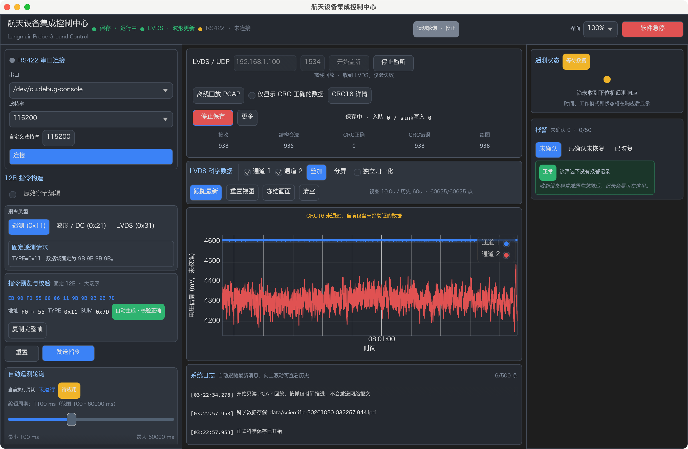
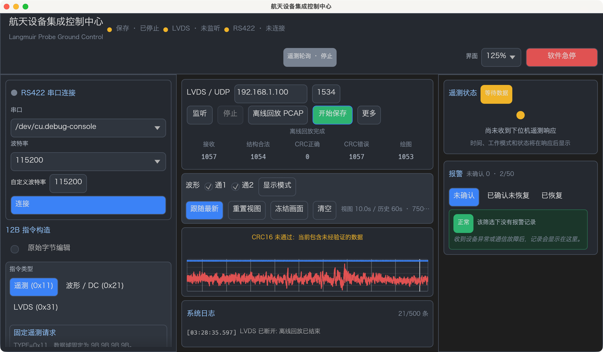

# LVDS 中央控制台布局精修与验收

日期：2026-10-20。HEAD：`3c60b1d05c4e3a924953ae25528241cf59dd7603`。源码位置指本轮工作区。

**中央布局、macOS 非 Mock Release 原生操作与截图 PASS；Mock workspace 241 passed、0 failed、1 ignored，外部用户 PCAP 专项已单独 PASS。Windows x64 非 Mock Release EXE / ZIP 已生成，PE 架构及导入表检查 PASS；Windows 原生启动与视觉验收 NOT_RUN。严格 workspace Clippy 仍为 FAIL。**

本轮只修改 `app.rs` 的布局/错误文字展示及 `app_layout_tests.rs`；未改通信、科学解码、回放、缓存、存储或主题实现。状态 `PASS` 表示实际通过，`FAIL` 表示实际失败，`NOT_RUN` 表示未执行。

## 1. 修改前根因

首先执行 `git status --short`、`git diff --stat`。开始时已有累计 22 个 tracked 修改文件、6052 insertions / 1040 deletions，以及前阶段未跟踪模块、报告、截图和用户 PCAP。完整开始快照保存在 `/private/tmp/langmuir-control-layout.phcPnp/baseline.tar`，解包对照位于同目录 `source/`。

| 现象 | 修改前源码及真实 Rect 证据 |
| --- | --- |
| IP、端口、按钮及状态拥挤 | 宽度只按 540pt 阈值决定是否塞进同一行，没有独立状态预算。长状态虽 `truncate()`，却没有受约束的剩余宽度。窄时 IPv4 输入缩至 82pt。 |
| 保存按钮显得过大 | 实测保存与监听按钮都为 **22pt 高**，不能说保存实际更高。保存强制宽 100pt，监听自然宽约 64pt，绿色强调进一步放大视觉差异。 |
| 文字及中心线不一致 | 全局控件为 32pt，中央局部覆写成 22pt；功能行又混用 26 / 22 / 18pt，IPv4 和端口字体不同。外框居中没有验证真实字形基线。 |
| 统计不稳定 | 每列将“标签 数字”合成一段居中文字；外部列等宽，数字自身位置仍随位数变化。 |
| 控制区拥挤但下方留白 | 1360 窗口的操作 dock 为 664×136pt，卡片内部 646×118pt；宽布局实际内容仅 88pt，加框为 106pt，留下 **30pt 空白**。窄布局又额外插一行。 |
| 136pt 已不足 | 三行普通 32pt 控件已需 96pt，再加独立接收状态、两行统计、组间距及内边距，无法装入原 136pt。 |
| 空态说明分散 | 顶部同时显示质量及鼠标操作说明，图中再放标题和长解释；内层 `vertical()` 恢复起始对齐，文字组没有真正垂直居中。 |

根因在改动前记录。保存按钮的视觉印象与真实尺寸分开处理。

## 2. 固定区域与高度预算

`central_layout_rects()` 按可用视口选择预定义布局，数据和文字不参与高度计算。中央仍无整体 ScrollArea；图表主体获得剩余高度，工具栏停靠，日志固定底部。没有提高最小窗口尺寸。

| 客户区 / UI 缩放 | 中央 root（pt） | 旧操作 / 工具栏 / 图表 / 日志高度 | 新操作 / 工具栏 / 图表 / 日志高度 |
| --- | --- | --- | --- |
| 1360×860 / 100% | 664×784 | 136 / 68 / 402 / 160 | **216 / 86 / 304 / 160** |
| 1600×900 / 100% | 904×824 | 136 / 68 / 442 / 160 | **216 / 86 / 344 / 160** |
| 1280×720 / 125% | 428×456 | 136 / 68 / 74 / 160 | **154 / 86 / 118 / 80** |

旧值由开始快照的固定分区函数和相同 root 计算；新值同时经真实窗口 `UI_RECT` 与 themed egui 测试核对。各区域间保留 3×6pt 间隔。125% 下逻辑视口为 1024×576pt，使用原有 104pt 紧凑顶栏；截图的 macOS 外框另含 28pt 标题栏。

常规操作卡片外高 216pt、内高 190pt，内边距 12pt 加 1pt 边框。预算为：监听配置/独立状态 **32+20**，回放/CRC **32**，正式保存 **32**，统计 **16+22**，三处分组间距 **12**，合计 190pt。1360 与 1600 下内部宽分别为 **638 / 878pt**，不再保留原来无用途的 30pt。

可用中央高度低于 620pt，或中央宽度不足 320pt时，使用 154pt 紧凑操作区与 80pt 日志。配置行、操作行各 32pt，状态 20pt，统计 38pt，行间距 4pt；1280/125% 下内部宽 **410pt**。CRC 过滤、详情及保存明细收进“更多”，保存按钮悬停也有明细；监听、停止、回放、保存保留直接按钮。极窄中央区将监听/保存放进“操作”菜单。宽度不足但高度充足的窗口有明确 256pt 两行监听预设。病理性零/微小 root 的分区仍保留原有界限测试，不作为可用桌面尺寸的视觉承诺。

日志 ScrollArea 设置 `min_scrolled_height(0)`，修复默认最小滚动高度使 80pt 日志实际长到约 119pt 的问题。日志只在自己的区域滚动。

## 3. 按钮、输入与真实文字对齐

局部统一 `CENTRAL_CONTROL_HEIGHT=32pt`、同行间距 8pt、按钮 padding 8×5pt，沿用主题字号、圆角及配色。常规监听和保存按钮均 **80×32pt**；IPv4 **124×32pt**、端口 **48×32pt**。紧凑按钮缩短宽度和标签，保持 32pt 高。IPv4 始终完整显示，不被缩到原 82pt。

IP TextEdit 与端口采用同一个 Button 字体；输入框设置垂直居中。最初保留 IP monospace 时，125% 下实际字形中心相差约 4pt，因此修正字体，而非只放宽外框断言。

`app_layout_tests.rs` 读取实际 `Shape::Text`、glyph baseline、`visual_bounding_rect()` 和绘制的控件 Rect。实测 100% 下 IP 与监听基线均为 **99.00pt**、保存基线 **207.00pt**；125% 下 IP 基线 **139.00pt**，与端口差小于 **1pt**。同行 CJK 按钮/工具栏基线误差不超过 0.5pt，输入两者基线不超过 1pt，数字可见字形中心差允许 2pt，包含字体实际墨迹高度和像素舍入差。每个普通按钮及输入绘制外框均为 32pt。这些是文字测量，不以外框等高代替文字对齐。

## 4. 监听错误与质量统计

只读检查本机 IPv4 为 `127.0.0.1`、`192.168.1.108`、`100.126.200.107`，不含原默认的 `192.168.1.100`。真实点击该地址的监听后得到：

```text
Can't assign requested address (os error 49)
```

界面单独 20pt 状态行显示 **“监听失败：本机未配置该 IP 地址”**，悬停保留 `接收异常：...` 完整原文。长状态只在固定宽度内截断，不推挤按钮。其他错误不改成 CRC 或科学数据错误；地址不可用数字码按 macOS 49 / Linux 99 / Windows 10049 限定并完整匹配，避免把 macOS 的 ENOSTR 99 或错误码 490 误分类。英文明确错误描述也可识别。

backend 绑定失败的 `connected:false` 原实现未改。实际界面仍显示未监听；未监听时尝试开始保存仍被原 backend 拒绝，不伪造运行。IP、端口默认值、目标设备源过滤和连接行为均未改变；没有枚举选择控件或自动改为 `0.0.0.0`。

统计采用五个等宽列，标签为“接收 / 结构合法 / CRC正确 / CRC错误 / 绘图”；上行 16pt、下行 22pt，数字 monospace。常规 1360 / 1600 / 紧凑 1280 的列宽分别约 **121.2 / 169.2 / 75.6pt**。0、9、1057、9999、10000、u64::MAX、长错误和保存开关均实测不改变列中心、基线、dock 和图表位置。超出单元宽度的极大数使用省略及完整数值 Tooltip，宽度不会增长。

CRC 统计不冒充正式 Accepted，绘图不冒充落盘。后台快照每 500ms 刷新，绘图随事件更新，运行截图可能暂时显示不同采样时刻的数字；最终截图核对最终值。

## 5. 工具栏与空态

工具栏使用固定两行，每行 32pt、行间 8pt，加原 subtle frame 共 86pt。第一行是标题、通道和显示模式；第二行是跟随、重置、冻结、清空及视窗/历史信息。窄时显示模式进入明确菜单，极窄时使用通道及图表操作菜单，不依赖自然换行。缓存点数过长只截断信息文本，悬停显示完整值和鼠标操作帮助。

图表保留固定质量与游标信息行，鼠标操作说明移至工具栏 Tooltip。空态只显示居中的“暂无 LVDS 数据”与“请开始 UDP 监听或离线 PCAP 回放”；采用字体实际行高和 `Align2::CENTER_CENTER` 对齐一个文字组，不用空白 spacer 拼位置。有数据时继续使用原 Plot 区域。未修改左键拖动、滚轮缩放、ManualView / FollowLatest、冻结、分屏同步、60 秒历史和峰谷缓存逻辑。

## 6. 原生窗口验收及截图

正常启动最终 `target/release/langmuir-desktop -NSAppSleepDisabled YES`，未启用 Mock。原生鼠标实际执行打开 PCAP、开始回放、关闭弹窗、保存开始/手动停止、更多菜单、清空、绑定失败及缩放选择。截图均为真实应用窗口，非 headless 渲染。

| 场景 | 实际结果 / 截图 |
| --- | --- |
| 1360×860 / 100% 无数据 | PASS：[空态](qa/LVDS_CONTROL_EMPTY_1360.png) |
| 1360×860 / 100% 回放中、保存中 | PASS：[双通道及 CRC 统计](qa/LVDS_CONTROL_REPLAY_SAVING_1360.png) |
| 1360×860 / 100% 回放结束 | PASS：[1057 / 1054 / 0 / 1057 / 1053](qa/LVDS_CONTROL_COMPLETE_1360.png) |
| 1600×900 / 100% | PASS：[同一最终数据的完整窗口](qa/LVDS_CONTROL_COMPLETE_1600.png) |
| 1280×720 / 125% 直接回放结束 | PASS：[紧凑布局及最终统计](qa/LVDS_CONTROL_COMPLETE_1280_125.png) |
| 1280×720 / 125% 空态 | PASS：[两行居中说明](qa/LVDS_CONTROL_EMPTY_1280_125.png) |
| 紧凑低频入口 | PASS：[更多中的 CRC 过滤、详情和保存统计](qa/LVDS_CONTROL_MORE_1280_125.png) |
| 最终版真实 Bind 错误 | PASS：[独立中文状态与原始错误 Tooltip](qa/LVDS_CONTROL_BIND_ERROR_1280_125.png) |
| 紧凑保存手动开始 / 停止 | PASS：[保存中](qa/LVDS_CONTROL_COMPACT_SAVING.png)、[03:27:52 手动停止](qa/LVDS_CONTROL_COMPACT_STOPPED.png)；回放继续、按钮位置不变 |





三种尺寸均检查：控件无重叠、完整 IPv4、统一控件高度、统计网格、长状态不挤按钮、工具栏固定两行、图表不遮日志、中央无整体滚动。125% 的图表绘制区域约 410×55pt，面积小于常规窗口；原有小图隐藏坐标轴策略保留，不宣称与大窗口同等观察面积。左侧仍可独立滚动。

最终版 1360 原速回放从本地 **03:22:34.278** 至 **03:23:27.078**，之后继续观察超过 60 秒总区间；1280/125% 再次原速回放也完成 1053 帧。每次原 PCAP 的实际动态输入约 **52.8 秒**，不能写成一次原 PCAP 提供了连续 60 秒输入。另在全部三种尺寸以注入设备时间执行 **1201 帧、0..60 秒、每帧 50ms** 的混合质量数据，逐秒渲染并比较真实四区 Rect 与统计基线，全部稳定，历史有界、显示每路不超过 2000 点；这是确定性 60 秒动态布局测试，未冒充原生性能或设备实收基准。

早期探索回放期间发生窗口尺寸和清空变化，其结束绘图计数 230 未用作最终通过证据；最终版重新完整回放、无清空情况下的最终值为 1053。保存结束后点击“开始保存”得到原有“请先连接 LVDS”错误，1360/1600 截图保留该真实错误，不把它说成新的绑定或 CRC 错误。

## 7. PCAP、CRC 和保存回归

原件 `2026101902--朗缪尔.pcapng` 389712B，开始及结束 SHA-256 相同：

```text
5937b2da0cc833946bc082c03f9ea9c1ab1424427769c4a071ed893ead50eb2f
```

外部 E7 实际经过 PCAPNG → 24B UDP → 原重组 → 269B 校验/诊断 → Controller → 事件及真实 BinarySink，独立读取统计如下，未硬编码旧报告作为运行结果：

| 实测 | 默认允许候选绘图 | 严格过滤 |
| --- | ---: | ---: |
| 总包 / 目标 UDP / 完整候选 | 1059 / 1057 / 1057 | 1059 / 1057 / 1057 |
| 结构合法 | 1054 | 1054 |
| CRC 正确 / 错误 | 0 / 1057 | 0 / 1057 |
| 可解码未验证候选 | 1053 | 1053 |
| 绘图事件 / 每路累计样本 | 1053 / 131625 | 0 / 0 |
| Accepted / 入队 / sink 写入 | 0 / 0 / 0 | 0 / 0 / 0 |
| 关闭重开后记录 / 长度 | 0 / 32B | 0 / 32B |

3 个头错误和 1 个次级时间错误不绘图。正常实际 GUI 保存生成 `data/scientific-20261020-032257.944.lpd` 与手动停止的 `data/scientific-20261020-032743.797.lpd`，关闭后均为 32B 头，正式记录为 0。早期探索另生成 `data/scientific-20261020-031713.924.lpd`，同样 32B；均保留，未覆盖旧文件。正式存储不使用图表抽稀数据，未改变 `.lpd` / HDF5 质量含义和格式。

## 8. Cargo 与自动化结果

| 实际命令 | 结果 |
| --- | --- |
| `cargo fmt --all -- --check` | PASS |
| `cargo check --workspace --locked` | PASS |
| `cargo test --workspace --features langmuir-desktop/mock --locked` | PASS：**241 passed、0 failed、1 ignored**；core89 / desktop113 / CLI5 / storage9 / transport25 |
| `cargo test -p langmuir-desktop --features mock --locked e7_user_capture_strict_and_diagnostic -- --ignored --nocapture` | PASS：用户原件专项 1 |
| `cargo build --release -p langmuir-desktop --locked` | PASS：最终 macOS 非 Mock Release，8.60s |
| `cargo clippy --workspace --all-targets --locked -- -D warnings` | **FAIL**：既有 framing assert_is_empty、CLI chunks_exact_to_as_chunks、storage explicit_iter_loop |
| 既有 allow-list 的分离 Clippy，含 Mock | PASS，仅诊断；不代替严格 FAIL |
| `git -c core.whitespace=cr-at-eol diff --check` | PASS |

首次沙箱内的两个既有 localhost UDP 绑定测试被 `Operation not permitted` 阻断；允许本机回环后，同一完整 workspace 命令通过。没有对真实设备建立连接。原 235 项覆盖保留，新增 6 项：5 项 UI 布局测试和 1 项跨平台 Bind 文字分类测试。布局还保留原来的两项完整 themed 控件测试。严格解码、双通道125点、UDP TTL、去重、序号观察、RS422黄金指令、参数精确输入、鼠标交互和正式保存回归保持通过。

分离 Clippy 只使用此前报告的显式 allow-list；新测试发现的 `manual_midpoint` 已改用 `f32::midpoint`，未增加 lint 豁免。HDF5 feature 运行、真机 UDP/串口和长时设备性能 NOT_RUN，未由布局验收代替。

本轮沿用已读取的 [ui-ux-pro-max](/Users/lingyuancong/.codex/skills/ui-ux-pro-max/SKILL.md) 的分组、稳定布局、附近错误反馈和数据图表指导；主题配色保持。该技能附带搜索脚本路径仍不可执行，未声称运行设计搜索。

## 9. Windows x64 非 Mock 交付

已生成 [Windows ZIP](../target/delivery/LangmuirGroundControl-windows-x64.zip)、[EXE](../target/delivery/windows-x64/LangmuirGroundControl.exe) 和 [使用说明](../target/delivery/windows-x64/README.txt)。ZIP 3,886,111B，EXE 9,187,328B，ZIP 完整性检查 PASS。解压后运行 EXE，无需 Rust/Cargo；PCAP 原件不打入发布包，填写自己的完整路径即可。

通过官方 cargo-xwin 0.23.1、Microsoft CRT / Windows SDK、Rust `x86_64-pc-windows-msvc` 目标实际复建，最终耗时 **9.27s**，`--locked --offline`，`RUSTFLAGS='-C target-feature=+crt-static'`，包选择 `-p langmuir-desktop --release`，feature fingerprint 仅 `[default]`、无 Mock。产物经 `file` / `llvm-readobj` 确认为 **PE32+ AMD64 0x8664**；静态 CRT，导入表无 vcruntime / msvcp / ucrtbase，仅 Windows 系统 DLL。

链接保留 Microsoft CRT 原始调试 PDB 缺失的 **LNK4099 warning**，构建退出 0。原 main 未配置 Windows GUI subsystem，本轮保持 CUI 行为，启动时可能同时出现控制台。**Windows 机器原生启动、视觉和设备验收 NOT_RUN**；这里交付 Windows 可执行产物，不能将 macOS GUI 或 PE 检查称为 Windows 发布运行验收完成。

```text
最终 app.rs SHA-256
de87271c2025d0eea0fb19cff624db4b5752143c3d50dbb1a9d2dd3ba272a6c9
EXE SHA-256
5affdd39948846b32f46dc6dbfff4404c4c4e53d1384748ac74cf101e3494cb9
ZIP SHA-256
1e6826a1deeb607e51ce8a499b294432715eb73f19d976ca5a5517817701e1e2
```

## 10. 修改清单与停止点

| 本轮文件 | 内容 |
| --- | --- |
| `apps/desktop/src/app.rs` | 固定高度预设、32pt 控件、功能分组、五列统计、Bind 展示、两行工具栏和空态 |
| `apps/desktop/src/app_layout_tests.rs` | 原两项保留，新增实际字形、统计/状态、交互状态确认、空态、60秒稳定性测试 |
| 本报告、`docs/qa/LVDS_CONTROL_*.png` | 实际截图及验收限制 |
| `target/delivery/` | Windows EXE、ZIP、README，属于 Git 忽略的构建交付目录 |
| `data/` 中上述 3 个32B文件 | 本轮真实 GUI 保存验收输出，保留可查 |

逐目录对照开始快照确认 `apps/` 只有以上两个预期文件变化；`crates/`、`tools/`、Cargo.toml、Cargo.lock 字节不变。旧报告和旧截图保留，用户 PCAP 哈希不变。backend、bridge、buffer、perf、main、theme 均未改。CRC算法及覆盖、269B、24B、差分恢复、TTL、去重、P1-3、RS422、真实回放、`.lpd` / HDF5 schema、P1-4 均未变。

最终累计 tracked diff 为 **22 个文件、6245 insertions / 1074 deletions**，包含之前全部阶段，不是本轮独立差异，也不包含未跟踪文件。没有 Git 提交、重置、清理或删除用户文件。本轮测试窗口正常退出后停止，不进入其他阶段。
