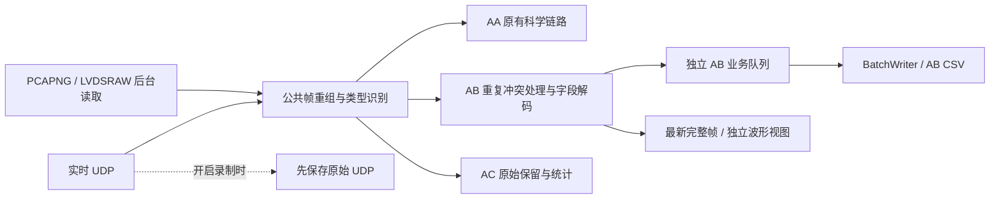

# Langmuier Probe Ground Control 开发报告

**阶段：LVDS-MULTITYPE-S02——AB 激励信号解码、独立波形与科学文件保存**  
**报告日期：2026-11-19（北京时间）**  
**开发与验证证据日期：2026-11-18**  
**项目目录：`D:\RUST\langmuier`**

本报告依据已保存的源码、构建日志、测试记录和交付文件整理。2026-11-19 重新核对了 EXE 的大小及 SHA256，与原构建证据一致；测试数量采用 2026-11-18 的执行记录。

## 一、阶段成果与当前状态

S02 已实现 AB 激励信号完整解码、独立 100 点波形、独立 CSV 保存，以及 PCAPNG/LVDSRAW 历史逐帧查看和导出。软件沿用 S01 的统一接收与原始归档链路，保留 AA 科学数据、LPD/CSV 格式和既有 RS422 星务模拟功能。

全工作区自动化测试为 **469 通过、0 失败、7 项默认忽略**，较 S01 的 420 项通过增加 49 项。另显式执行真实 AA 数据专项 5 项，全部通过。Windows x64 非 Mock、静态 CRT Release 已构建，并按要求交付单个 EXE。

**当前状态：软件实现及自动化验证已完成，原生 Windows GUI 实际操作验收和真实 AB 硬件联调尚未完成。** 合成数据验证不能替代真实设备验收，现有真实抓包也不含已确认的 AB/AC 数据。

## 二、开发目标与范围

| 模块 | 本阶段结果 |
|---|---|
| 公共 LVDS 接收 | 复用 S01 的固定 269B 公共帧、UDP 分片重组、类型识别及外层 u32 序号监测 |
| AA 科学数据 | 保留原解码、双通道绘图、11 列 CSV、LPD v3 与异常恢复功能，并执行回归 |
| AB 激励信号 | 新增完整字段解码、时间重建、三种模式显示、独立波形与 CSV |
| AC GNSS/姿态 | 继续保留原始数据、来源及统计；详细业务解码留在后续阶段 |
| 历史文件 | 新增 PCAPNG/LVDSRAW 中 AB 的逐帧选择、错误查看与 CSV 导出 |
| RS422 星务模拟 | 保留既有实现，纳入自动化回归；本阶段未实施新的控制业务 |
| 软件交付 | 单个 Windows x64 正式 EXE，未制作新的压缩包 |

## 三、协议实现

协议依据为原始工作簿 `协议 (PH20261115).xlsx`，重点核对 `LVDS_激励信号数据包!I17:J31`、`F34:F38` 和 `LVDS_公共格式`。

AB 帧总长 269B，DATA 从整帧偏移 7 开始，占 260B；多字节字段全部采用大端。解码内容如下：

| DATA 偏移 | 长度 | 字段 | 单位或约束 |
|---|---:|---|---|
| 0 | 4B | 设备累计秒 | 自 2018-01-01 起，时间对应最新采样点 |
| 4 | 4B | 微秒偏移 | 0–999999µs |
| 8 | 4B | 实际频率 | mHz，除以 1000 后为 Hz |
| 12 | 2B | 采样间隔 | µs，使用包内值 |
| 14 | 2B | 采样点数 | 固定 100 |
| 16 | 1B | 工作模式 | 0x55 三角波、0xAA 正弦波、0xBB DC |
| 17 | 1B | 扫描频率设定 | 三角/正弦模式为 0–100；DC 保留原字节 |
| 18 | 2B | DC 设定电压 | DC 为 0–5000mV；其他模式为 0 |
| 20–21 | 各 1B | AD9833、DAC8563 状态 | 原始 0/1，不推断正常或故障 |
| 22 | 1B | 最近科学包序号 | 与 AB 自身序号独立 |
| 23 | 1B | PA0 包序号 | u8，支持 255→0 |
| 24 | 36B | 保留字节 | 全 0 |
| 60 | 200B | 100 个 u16 波形点 | mV，范围 0–3300 |

尾部原始 CRC 两字节保留，生产接收按本阶段要求不执行 CRC 校验，记录 `CRC_NOT_CHECKED`。

Excel 明确规定时间戳对应 `wave[99]`，程序按以下公式计算每一点的设备时间：

```text
t_i = t_latest - (99 - i) × interval_us，i = 0…99
```

时间计算使用 u64 与检查减法，拒绝下溢。采样间隔不套用 AA 的 500µs，也不固定为 10000µs。以 interval=10800µs 为例，100 点首尾跨度为 1.0692 秒，因此相邻 AB 窗口可以重叠。

AB 电压直接按 `mV / 1000` 转为 V；931mHz 显示为 0.931Hz。全零波形或实际频率为零，只要结构合法仍可接纳；全零显示“有效性未确认”，不生成替代波形或推断通信故障。

## 四、系统实现与数据流

核心实现继续使用 Rust 工作区，界面采用 egui/egui_plot，异步存储复用既有 BatchWriter。



### 4.1 解码与来源追踪

`ExcitationFrame` 保存设备字段、100 个原始 mV 样本及原 CRC；`ExcitationRecord` 补充外层完整 u32、原始记录 ID、来源、会话及接收时间。只有通过既有重复/冲突处理的 AB 才进入正式解码和保存。

AB 解码错误按字段分类，原始 UDP 仍由录制链路保留，AB 业务错误不会混入 AA 的解析失败计数。实时原始归档的会话标识会传递给 AB 数据，支持与历史重扫结果对应。

### 4.2 独立 CSV 与过载处理

每个接纳的 AB 包写入 100 行 CSV，采用需求中的 19 列，并附加来源、会话、接收时间，共 22 列。保存原始 mV、计算 V、逐点设备时间、频率、模式、状态、序号和完整性标记。

CSV 按实际接纳顺序写入，保留重叠或逆序的设备时间窗。文件独占创建，禁止覆盖；停止或 EOF 时关闭，写入与关闭错误明确上报。

AB 正式保存直接从后端业务链路获取数据，独立于界面显示队列。业务队列上限 1024，BatchWriter 队列上限 512，辅助视觉队列上限 128；各自的过载和写入计数分开报告。切换 AA/AB 视图、冻结或缩放不会停止后台保存。

### 4.3 波形与历史查看

中央工作区增加“科学波形 AA / 激励波形 AB”下拉选择。AB 默认显示最新一帧的完整 100 点，具备独立的跟随、手动查看、冻结、重置、平移、缩放和鼠标点值状态。相邻帧不会直接拼接，AA 与 AB 的波形缓存和交互状态独立。

历史读取、AB 选择与 CSV 导出在后台执行；界面仅保留所选单帧和有界错误信息。AB 导航可取消，AA 导航不会取消 AB 选择。为保留分片和去重上下文，当前 AB 定位从文件前缀重扫，复杂度为 O(前缀长度)；超长文件的随机定位仍有优化空间。

## 五、主要代码与交付文档

以下为 S02 相关的主要文件；工作区同时保留了用户原有、S01 和星务模拟器的未提交变更，不能将全部 Git 差异归属于本阶段。

| 文件或目录 | 职责 |
|---|---|
| `crates/langmuir-core/src/excitation.rs` | AB 模型、字段校验、逐点时间及分类错误 |
| `crates/langmuir-storage/src/excitation_csv.rs` | 独立 AB CSV 编码与文件生命周期 |
| `apps/desktop/src/backend_excitation.rs` | AB 业务路由、异步存储及可靠计数 |
| `apps/desktop/src/backend.rs`、`bridge.rs` | 接入公共分流、后端请求、事件及状态 |
| `apps/desktop/src/backend_excitation_history.rs` | 历史按需选择、取消及 CSV 导出 |
| `apps/desktop/src/backend_history.rs` | 历史主流程集成与稳定会话信息 |
| `apps/desktop/src/app_excitation.rs` | AB 波形、元数据、保存与导航控件 |
| `apps/desktop/src/app.rs`、`app_history.rs` | 中央工作区及历史窗口集成 |
| `*excitation*tests.rs`、`app_layout_tests.rs` | 解码、存储、历史、交互及布局回归 |
| `tools/qa/lvds_excitation_reference.py` | 独立 Python 合成编码器和 CSV 读回 |
| `tools/qa/lvds_excitation_workbook_audit.py` | 原始工作簿单元格提取 |
| `docs/qa/lvds-multitype-s02/` | 测试、构建、读回与发布证据 |

详细字段追踪和验收记录见 [S02 验收报告](LVDS_MULTITYPE_S02_EXCITATION_ACCEPTANCE.md)，操作说明见 [Windows 使用说明](WINDOWS_README.md)。

## 六、开发中修复的关键问题

| 问题 | 处理结果 |
|---|---|
| 视觉队列拥堵可能影响 AB 正式保存 | 建立独立业务供给；200 帧测试中视觉队列淘汰 72 项，CSV 仍保存 200 帧、20000 行 |
| 关闭超时被提前计作数据丢失 | 区分未完成写入与已确认丢失，后台结束后核对最终计数 |
| 开始原始录制后 AB 会话信息缺失 | 使用实际原始归档 Header.session_id，验证实时与历史来源一致 |
| 切换来源时文件关闭行为不一致 | 有效来源断开或切换时关闭 AB CSV，同时保留未连接时预先开启保存的用法 |
| 历史命令队列满导致已接纳选择失效 | 仅接纳的请求推进选择版本，拒绝的新请求不会取消旧任务 |
| 历史更新覆盖手动或冻结画面 | 保留当前帧快照，明确导航完成或恢复跟随时再切换 |
| 旧会话显示事件覆盖新来源波形 | 按权威来源及会话接纳显示事件，阻止断开后复活旧帧 |
| 历史导出尚未结束却显示“已导出” | 路径采用中性“输出路径”标签，错误与进行状态独立显示 |

上述关键回归均有对应自动化测试；相关故障复现与修复记录保存在阶段验收资料中。

## 七、测试与验证结果

### 7.1 全工作区检查

| 检查 | 保存的执行结果 |
|---|---|
| `cargo fmt --all -- --check` | 通过，退出码 0 |
| `cargo check --workspace --locked` | 通过，退出码 0 |
| `cargo test --workspace --features langmuir-desktop/mock --locked` | 469 通过、0 失败、7 项默认忽略 |
| `cargo clippy --workspace --all-targets --locked -- -D warnings` | 通过，退出码 0 |

7 项默认忽略保留在统计中，不视作全部通过。另显式执行其中真实 AA 相关专项 5 项，全部通过；这些结果单独记录，不重复计入默认 469。其余两项为 CPU 性能基准和原生 GUI 派生文件专项，尚未执行。非 Mock 混合回放属于同一专项的再次验证，也不累加为新的独立测试数量。

### 7.2 AB 独立合成验证

Python 标准库编码器生成三角、正弦、DC、全零四类固定 SYNTHETIC 向量；Rust 生产解码器读取固定字节，CSV 与独立生成的 400 行期望结果全文核对。

覆盖范围包括：0/3300mV、931mHz、10800µs、序号回绕、独立科学序号、跨秒倒推、任意 CRC，以及点数、保留字节、模式、状态、频率设定、电压、微秒和下溢等错误条件。

`20 AA + 1 AB + 1 AC` 合成混合流的验证结果为：

| 指标 | 结果 |
|---|---:|
| UDP 数量 | 22 |
| AA 科学帧接纳 | 20 |
| AB 解码帧 | 1 |
| AB 完整波形点 | 100 |
| AB CSV 数据行 | 100 |
| AC 公共接收 | 1 |
| 外层序号假缺口 | 0 |

另覆盖缺少辅助包、交换辅助顺序、重复与冲突、分片不完整、来源变化及队列过载。非 Mock 回放实际经过后端与文件写入链路；最终 AB CSV 经 Python 逐点读回，时间、mV、V、频率、模式、状态及来源字段核对通过。

### 7.3 真实 AA 回归

使用 `D:\RUST\2026102401.pcapng`，原始文件保持不变。结果为：

| 指标 | 结果 |
|---|---:|
| 原始 UDP 记录 | 467 |
| UDP Payload 总字节 | 136830 |
| 原生 AA 科学帧 | 237 |
| 恢复候选 | 229 |
| 拒绝记录 | 1 |
| 每通道科学点数 | 23700 |
| 科学 CSV 数据行 | 23700 |
| 科学 LPD 文件大小 | 96973B |

全部 467 条原始 UDP 另行归档后重开，逐字节及元数据核对一致，正常结束记录和 EOF 通过，原始归档丢失数为 0。该真实文件不包含已确认的原生 AB/AC，不能用来证明 AB 真机通过。

## 八、EXE 交付

| 项目 | 内容 |
|---|---|
| 程序名 | `LangmuierProbeGroundControl.exe` |
| 路径 | `D:\RUST\langmuier\target\delivery\lvds-multitype-s02-20261118\LangmuierProbeGroundControl.exe` |
| 平台 | Windows x64 / MSVC |
| 构建 | Release、非 Mock、静态 CRT |
| 文件大小 | 10787328B，约 10.29MiB |
| SHA256 | `8ab70f1d12991deedcea554e0f20f749160046ec1074a5e637fb7b79b29ec419` |
| 交付形式 | 单个 EXE；原 S01 交付物保留 |

PE 检查为 AMD64/PE32+，没有动态 CRT 导入，交付 EXE 与 Release 构建逐字节一致。正式 EXE 已运行混合及真实 AA 抓包的 CLI 审计，`--mock` 启动请求也已被正式构建拒绝。CLI 审计本身不保存科学 CSV，不能据此宣称已完成原生 GUI 保存验证。

程序启动时由用户手动选择数据来源和通信操作。文件回放与历史查看不需要连接硬件。

## 九、当前限制与使用反馈

| 项目 | 当前状态 | 后续需补证据 |
|---|---|---|
| Windows 原生 GUI 操作、截图和 GUI 触发 CSV 读回 | NOT_RUN；开发会话缺少所需的界面操作工具 | 在正式 EXE 中实际打开文件、切换 AB、平移缩放、冻结恢复、保存并读回，保留截图 |
| 真实 AB 与真实 AA/AB/AC 混合设备输入 | BLOCKED；未提供真实 AB 抓包或设备输入 | 获取原始输入，核对模式、时间、频率、样本及混合流计数 |
| 厂商状态含义 | 当前只确认 0/1 字段 | 厂商明确各状态取值含义后，再添加解释 |
| 超长历史随机定位 | 后台重扫，不阻塞 egui；仍为 O(前缀长度) | 通过大文件实测评估是否增加 AB 专用定位索引 |
| 长时间设备负载和网络运行 | 尚缺本轮真实设备实测 | 连续采集并核对接收、归档、CSV、丢失与错误计数 |
| CPU 性能基准 | 默认忽略的基准项未运行 | 按独立性能任务执行并记录环境与结果 |

用户已反馈“找不到打开历史、切换 AB 和 AB CSV 的入口”。当前实际入口为：

1. 中央操作区“离线回放 PCAP”附近的“打开历史数据”；紧凑布局显示“历史”。
2. 波形图上沿左侧的“科学波形 AA”下拉框，切换为“激励波形 AB”。
3. 切换后，同一行显示“AB 详情”和“AB CSV”。

当次进程检查还发现 S01、S02 同时运行，两个版本窗口名称相同，增加了辨识困难。操作入口说明已经补充；入口可发现性仍应通过原生界面实测确认。**显示可见版本号、改善入口提示属于后续建议，尚未计入本轮已实现成果。**

## 十、后续收尾事项

优先补齐正式 EXE 的原生 GUI 验收和入口可发现性验证，再接入真实 AB 数据完成联调。真实输入需保留原始字节、采集来源和时间，按原始归档、解码、波形、CSV 逐层核对。

后续工作继续限定在 S02 收尾范围。AC 详细解码和完整三类型仪表盘不属于本报告已交付内容。

## 附：主要证据

- [详细验收报告](LVDS_MULTITYPE_S02_EXCITATION_ACCEPTANCE.md)
- [检查与发布汇总](qa/lvds-multitype-s02/verification-summary.json)
- [工作区测试日志](qa/lvds-multitype-s02/cargo-test.log)
- [最终非 Mock 混合回放](qa/lvds-multitype-s02/nonmock-mixed-replay-final.log)
- [最终 AB CSV 独立读回](qa/lvds-multitype-s02/ab-csv-final-independent-readback.json)
- [真实 AA 原始归档与恢复审计](qa/lvds-multitype-s02/real-AA-raw-tests.log)
- [真实 AA 科学文件回归](qa/lvds-multitype-s02/real-AA-science-tests.log)
- [EXE 校验记录](qa/lvds-multitype-s02/windows-exe-verification.json)
- [Windows 使用说明](WINDOWS_README.md)
