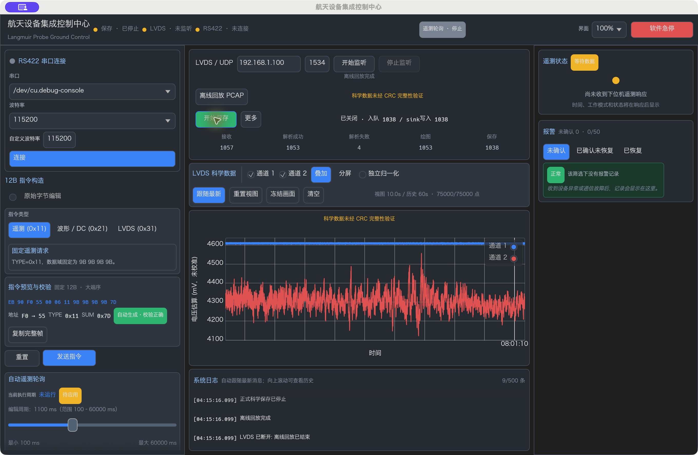
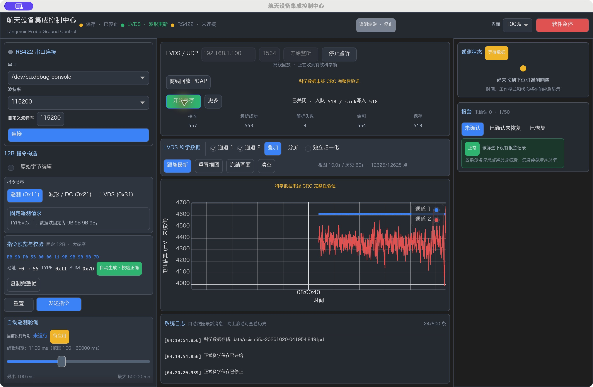

# LVDS 取消 CRC16 门禁端到端验收

日期：2026-10-20。开始 HEAD：`0479fc95e7c93a24dca4dae8de15c9660344d1a2`。源码位置指验收时的工作区；随后按用户要求提交并推送 GitHub。

**PASS：生产接收链不再计算或比较 LVDS CRC16。269B 帧通过结构、设备时间及两路 ADC 检查后，按原去重规则直接进入正常科学数据链；用户开启保存后进入原正式 writer。实际用户 PCAP 得到 1053 条科学记录，文件为 1,063,562B，关闭后全部读回一致。**

**科学数据未经 CRC 完整性验证。** 接收、绘图和保存成功不表示 CRC 合格。界面不再提供 CRC 模式、过滤或详情操作。

Mock workspace **241 passed、0 failed、1 ignored**；依赖用户 PCAP 的 ignored 专项已以非 Mock 测试构建单独执行 PASS。macOS 非 Mock Release 原生回放、双通道绘图、开始保存及手动停止实际通过。Windows x64 非 Mock Release EXE / ZIP 已更新，PE 和导入表检查 PASS；Windows 原生运行 **NOT_RUN**。严格 workspace Clippy **FAIL**，未以放宽 lint 替代严格结果。

状态：`PASS` 为实际通过，`FAIL` 为实际失败，`NOT_RUN` 为本轮未执行。

## 1. 开始状态与修改范围

首先执行 `git status --short` 和 `git diff --stat`。开始时 tracked diff 为空，仅用户原件 `2026101902--朗缪尔.pcapng` 未跟踪。此前阶段已在开始 HEAD 中；没有重置、覆盖或清理用户文件，验收截止时没有 Git staging、提交或推送。

先检查 core 解码、ScienceGate、旧流式入口、transport adapter、CLI、桌面 ingress / Controller 和科学 writer。发现旧正式入口共同依赖 `decode_scientific_frame_with_sequence()` 的 CRC 检查；桌面另通过 `diagnose_scientific_frame()` 创建只绘图的候选事件。因此仅移除 UI 开关不能使这些帧进入正式文件。

本轮修改共同生产解码准入，并删除桌面候选分支及对应 UI。没有修改 CRC 算法、269B / 24B 格式、差分恢复、TTL / 去重策略、序号算法、存储格式或用户原 PCAP。没有排查厂家 CRC 根因、修改原始字节、执行位移纠偏或尝试其他 CRC 算法。

## 2. 取消前后的完整调用链

| 入口 / 环节 | 取消前 | 当前生产行为 |
| --- | --- | --- |
| 旧 LVDS 流式入口 | `LvdsStreamDecoder` → 科学 decoder → 结构 / CRC / 时间 / ADC | 同一 decoder 只检查结构 / 时间 / ADC；transport reader 与 CLI 同步采用此规则 |
| 桌面 UDP | 来源过滤 → 24B 外层 → 原重组 → 诊断检查及严格 ScienceGate | 来源过滤 → 24B 外层 → 原重组 → ScienceGate，只有一条正常科学数据交付路径 |
| PCAP | 原 reader / 捕获时序 → 同一 ingress → 正式或候选事件 | 原 reader / 捕获时序 → 同一 ingress → 正常 `ScientificFrame` |
| 完整科学候选 | 严格 CRC 失败不能 Accepted；可解码候选另行绘图 | 结构 / 时间 / ADC 成功后按原完整 u32 序号及 269B 原字节去重 |
| Controller | Accepted 进入正式 handler；Unverified 只显示 | Accepted 直接进入 `handle_scientific_frame()`，发布 `ScientificSamples`，保存开启时交原 BatchWriter |
| 正式文件 | CRC 不匹配的候选不入 writer | 不以 CRC 为条件；原 `.lpd` v2 / HDF5 writer 接收已解析且去重后的科学帧 |

`lvds.rs` 的 `decode_scientific_frame_with_sequence()` 现在直接调用 `validate_scientific_frame_structure()` 和 `decode_scientific_body()`。`UdpLvdsScienceGate::accept_at()` 继续先调用共同 decoder，再登记正式去重状态，策略和原始字节身份不变。

`backend.rs` 的 `UdpLvdsIngress::push_at()` 复用 ScienceGate 结果，`record_complete_result()` 仅记录同一次解析结果，不重新解码或计算 CRC。UDP 和回放收到的正常帧均直接交 Controller。旧 `CrcMode`、`LvdsDelivery`、候选提取及双路线交付已移除。Accepted 之后才推进 P1-3 观察及正式 handler；非法时间不会生成伪造 UTC。

`diagnose_scientific_frame()`、`validate_scientific_frame_crc16()`、CRC 算法及参考测试保留为显式离线参考 API，正常接收链没有调用它们。CLI 科学输出标记 `integrity=CRC_NOT_CHECKED`。只读 `--audit-pcap` 不写科学文件，其输出明确标注 `file_frames=NOT_RUN`，没有把只读统计当作保存验收。

## 3. 当前准入、去重与保存规则

| 输入 | 绘图 / 正式科学帧 | 用户开启保存时 |
| --- | --- | --- |
| 269B、EB90、SRC55、DSTAA、LEN0107、TYPEAA，时间及两路 ADC 均合法 | 经原去重后直接 Accepted / 绘图 | 进入原 BatchWriter |
| 只修改末尾两个 CRC 字节 | 与原 ADC / 时间相同；不计算或比较 CRC | 首次合法准入可保存 |
| 修改科学区、保留原 CRC，仍可合法解码 | 使用实际修改后的 ADC | 保存实际解码值 |
| 长度、帧头、地址、声明长度、类型非法 | 明确拒收 | 不保存 |
| 微秒字段非法 | 拒收，提示无法建立可信设备时间 | 不编造时间，不保存 |
| 差分恢复后 ADC 越界 | 安全返回错误，不 panic | 不保存 |
| 同完整 u32 序号、相同全部 269B 原字节 | 原 Duplicate 抑制 | 不重复保存 |
| 同完整 u32 序号、不同合法原字节 | 原 SequenceConflict 抑制 | 不重复保存 |

尾部两字节仍存在于原帧中，也仍属于去重使用的完整原字节身份。因此同序号仅改变尾部字节会按原冲突规则处理；这属于内容冲突，不是 CRC 拒收。结构 / 时间 / ADC 失败不会登记正式去重状态，之后的合法帧仍可被接收。

保留原 2 秒残帧 TTL、64 槽容量恢复、5 秒 / 256 帧 FIFO 去重、完整 u32 序号监测和源端点过滤。保存停止只关闭写入，回放及绘图继续。EOF 正常关闭 writer；写入失败继续使用原失败处理，不回滚已经发生的科学准入或序号观察。

`.lpd` 仍为 v2、32B 文件头、1010B 每记录，UTC、微秒、u16 文件序号及两路各 125 个 u32 ADC 布局不变。完整 u32 去重与旧文件内 u16 序号分别保留原语义。HDF5 schema、异步批量写入、flush 及关闭流程未改，没有 Sidecar 或 P1-4 升级。

## 4. UI 简化与绘图边界

移除“仅显示 CRC 正确的数据”、严格 / 诊断模式、CRC16 详情、CRC 正确 / 错误主界面计数、诊断确认及独立候选波形状态。桥接层的 `SetDiagnosticPreview`、`DiagnosticSamples`、CRC 详情和模式快照已删除，Mock 请求处理同步清理。正常启动不启用 Mock，也不自动回放或连接设备。

现在只有一条 `ScientificSamples` 绘图通路。中央控制区及图表固定信息行明确显示“科学数据未经 CRC 完整性验证”。提示始终适用于当前数据，不暗示已校验；没有 CRC 操作按钮。原“更多”继续提供保存明细。

| 主界面计数 | 实际含义 |
| --- | --- |
| 接收 | 匹配来源的 UDP 数据报；包括分片及错误外层，不等同于完整科学帧数 |
| 解析成功 | 完整候选通过结构、时间及两路 ADC 检查，包含随后被去重 / 冲突抑制的合法候选 |
| 解析失败 | 完整候选的结构、时间或 ADC 解析失败；外层 / 残帧错误另在原协议指标中统计 |
| 绘图 | UI 实际消费并准入图表缓存的帧事件；冻结时后台接收和此计数仍可更新 |
| 保存 | 原 `sink_written`，表示 sink API 写入数；入队、关闭及错误仍分别显示 |

后端快照每 500ms 刷新，绘图计数随消费事件更新，所以运行截图可能暂时出现绘图大于最近一次解析快照的情况。最终 EOF 统计核对最终状态。显示通道仍有界并保留过载计数，不承诺任意压力下显示全部事件；保存不从图表或抽稀点反推。

通道开关、叠加 / 分屏、归一化、左拖、滚轮缩放、FollowLatest / ManualView、重置、冻结、60 秒有界历史、可见范围缓存及峰谷抽稀继续保留。删除的是无 CRC 检查下已无区分意义的逐点 Accepted / CrcUnverified 标签及扫描，不重写绘图算法。当前 `SamplePoint` 为 16B，原样本双路容量上界约 4.58MiB，冻结额外复制后约 9.16MiB；这不是进程 RSS 或性能实测结论。

本轮按已读取的 [ui-ux-pro-max](/Users/lingyuancong/.codex/skills/ui-ux-pro-max/SKILL.md) 的状态可辨识、稳定布局和附近说明指导保留固定提示行，未改主题。该技能附带脚本路径无有效脚本，未声称执行设计搜索。

## 5. 用户 PCAP 与完整正式文件实际结果

原件 `2026101902--朗缪尔.pcapng`，389712B。开始与最终 SHA-256 一致：

```text
5937b2da0cc833946bc082c03f9ea9c1ab1424427769c4a071ed893ead50eb2f
```

非 Mock 专项 `e7_user_capture_no_crc_science_roundtrip` 实际启动后台 PcapReplay，经过原 PCAPNG reader、UDP 外层、原重组、ScienceGate、Controller、显示事件及真实 BinarySink。保存从处理第一批数据之前开启。独立逐包结构 / 时间 / ADC oracle 及原规则的独立去重参考决定期望结果，没有硬编码 1053 作为期望。

| 实际指标 | 结果 |
| --- | ---: |
| PCAP 总包 | 1059 |
| 匹配来源 UDP / 完整候选 | 1057 / 1057 |
| 结构合法 | 1054 |
| 解析成功 / 失败 | 1053 / 4 |
| 头错误 / 时间错误 / 检出的 ADC 错误 | 3 / 1 / 0 |
| Accepted / Duplicate / Conflict | 1053 / 0 / 0 |
| 正常绘图事件 | 1053 |
| 每路累计事件采样点 | 131625 |
| writer 入队 / sink 写入 | 1053 / 1053 |
| writer 关闭 / 存储错误 | true / 无 |
| 关闭后科学记录 | 1053 |
| 关闭后文件长度 | **1,063,562B** |
| 每条 UTC、微秒、序号及两路各 125 点 ADC 读回 | **全部一致** |

实际长度满足 `32 + 1053 × 1010 = 1,063,562`。专项在临时目录创建真实 `.lpd`，正常关闭后重新读取文件字节逐条验证；测试结束按 tempdir 生命周期移除临时输出，不将其作为当前 `data/` 中的永久文件。原生 GUI 文件另见下一节。

两个非目标包只计入总包。结构合法中的一帧时间非法，所以 1054 不等于可保存的 1053。ADC 错误为 0 不说明被更早结构 / 时间检查拒收的帧也完成 ADC 检查。CRC 本轮没有计算或比较，不报告“CRC 合格数量”。

专项仅推进回放时钟以避免等待，未改设备时间、顺序或字节；捕获时序另有边界测试，原生 GUI 使用实际约 52.8 秒捕获间隔。本轮未测屏幕 FPS、长期 CPU / RSS 或硬件吞吐。

## 6. 非 Mock 原生窗口、开始保存与手动停止

使用当前 macOS 非 Mock Release，在正常真实后端实际点击 PCAP 回放、开始保存及停止保存。为原生自动化识别，临时 app bundle 包含同一 Release 可执行文件的字节副本；从工程目录启动，未改变后端、未添加模拟输入。窗口为 1360×860 / 100%，截图来自真实窗口。

第一次完整回放本地时间 `04:14:23.286` 开始、`04:15:16.099` 结束。开始回放后才点击保存，`04:14:24.037` 开始保存，因此不是全程提前开启保存：最终接收 1057、解析 1053、失败 4、绘图 1053、保存 **1038**。文件：

```text
data/scientific-20261020-041424.018.lpd
1,048,412B = 32 + 1038 × 1010
```

关闭后通过 `LANGMUIR_GUI_SCIENCE_FILE` 指定该文件绝对路径，非 Mock E7 逐条验证 PASS：与 PCAP 可解析记录从索引 15 起的完整后缀精确一致。不把 GUI 保存的 1038 条说成 1053，也不承诺开始保存前的数据会追溯写入。

另一轮真实操作在 `04:19:54.122` 开始回放、`04:19:54.856` 开始保存，`04:20:20.939` 实际点击停止保存。界面显示已关闭、入队 / sink 写入均为 **518**，回放和两路波形继续，直至 `04:20:46.923` 正常 EOF，绘图最终为 1053，保存仍为 518。文件：

```text
data/scientific-20261020-041954.849.lpd
523,212B = 32 + 518 × 1010
SHA-256 dd250214e0dd9ac6f02a0d5de1c11912937bb4d82e185ca4bdbce080abd5f6a6
```

对此手动停止文件另作独立只读审计，解析原 PCAPNG / Ethernet / IPv4 / UDP 及差分 ADC，全部 518 条记录匹配可解析帧的连续子区间索引 15..532（0-based），固定 v2 头、UTC、微秒、序号和两路 ADC 全部一致。没有改科学文件或 PCAP。

| 原生证据 | 结果 |
| --- | --- |
| [回放及正式保存中](qa/LVDS_NO_CRC_SAVING.png) | PASS：两路波形、保存运行及未经 CRC 验证说明可见 |
| [完整回放结束](qa/LVDS_NO_CRC_COMPLETE.png) | PASS：正常科学绘图 1053，实际 GUI 保存 1038，writer 已关闭 |
| [真实手动停止保存](qa/LVDS_NO_CRC_MANUAL_STOP.png) | PASS：停止后保存 518、writer 已关闭，回放继续；日志保留手动停止时间 |





探索操作曾在另一轮 EOF 后点击“开始保存”，得到原 backend 的“请先连接 LVDS”拒绝；未将该结果当作手动停止证据。正式手动停止截图来自上述 04:20:20 操作。测试输出保留在忽略的 `data/`，没有覆盖旧数据。

本轮 QA bundle 已正常关闭，进程退出 0；只读核对原有用户进程 87705 仍保留。未点击串口连接、UDP 监听或发送控制指令。原生验收为本轮回放 / 保存流程；布局尺寸、鼠标及长时间缓存状态由保留的自动化回归覆盖，不以本轮一张尺寸截图冒充完整跨平台视觉验收。

## 7. 必要回归覆盖

| 要求 | 实际覆盖与结果 |
| --- | --- |
| 正常 269B、CRC 尾部变化、科学区变化而 CRC 不变 | PASS：core 解码、旧流式 / transport reader、桌面 E2E 及真实文件读回均接受合法变化，ADC 使用实际新值 |
| 错误长度、头、SRC / DST、LEN / TYPE | PASS：原固定字段检查保留；桌面错误帧不显示、不写文件 |
| 非法微秒、ADC 越界、任意输入不 panic | PASS：原时间及差分范围保护保留；非法帧不污染去重 |
| 400 帧、50ms 间隔 | PASS：原 ScienceGate / 后台回放 / UI 场景更新为同一科学通路，每路累计 50000 点；显示点仍每路最多 2000 |
| 完整重复及合法序号冲突 | PASS：只接收首条，不重复写入；全 269B 比较与完整 u32 身份保留 |
| P1-1 TTL / 64 槽容量 | PASS：原超时边界、残帧回收和容量恢复覆盖保留 |
| P1-3 序号监测 | PASS：只有 Accepted 参与原观察；跳号、回绕、重启、超时等策略未改 |
| 绘图交互及性能结构 | PASS：左拖、滚轮、手动保持、跟随、分屏同步、冻结、归一化、可见缓存 / 峰谷、60 秒历史及布局测试保留 |
| 保存及失败 | PASS：原 writer、正常关闭、重复抑制、真实 BinarySink 重读及失败后状态处理 |
| RS422 | PASS：原六条黄金指令、SUM、参数精确输入及发送边界测试；未实际发串口 |
| CRC UI 移除 | PASS：控件绘制测试检查旧标签不存在，新完整性说明存在；原生窗口无 CRC 操作 |

原严格 CRC 门禁断言按新业务要求更新为合法接收断言；独立离线 CRC 算法 / 覆盖范围 / 大端字段参考测试仍保留。没有通过删除全部旧测试、放宽协议字段或修改原件达到数量要求。

## 8. Cargo 与构建实测

| 命令 | 实际结果 |
| --- | --- |
| `cargo fmt --all -- --check` | PASS |
| `cargo check --workspace --locked` | PASS，无编译警告 |
| `cargo test --workspace --features langmuir-desktop/mock --locked` | **PASS：241 passed、0 failed、1 ignored**；core89 / desktop113 / CLI5 / storage9 / transport25 |
| `cargo test -p langmuir-desktop --locked e7_user_capture_no_crc_science_roundtrip -- --ignored --nocapture` | PASS：正常非 Mock 测试构建、实际用户文件及完整正式文件读回 |
| 上述专项加绝对路径 `LANGMUIR_GUI_SCIENCE_FILE` | PASS：另核对原生 GUI 的 1038 条记录 |
| `cargo build --release -p langmuir-desktop --locked` | PASS：macOS 非 Mock Release，5.74s |
| `cargo clippy --workspace --all-targets --locked -- -D warnings` | **FAIL**：既有 framing / CLI / storage lint |
| 继承 allow-list 的分离诊断，含 Mock | PASS，仅诊断，不替代严格 FAIL |
| `git -c core.whitespace=cr-at-eol diff --check` | PASS |

完整 workspace 的 localhost UDP 测试在允许本机回环的执行环境中通过，没有连接设备。严格 Clippy 的最终错误为 `framing.rs:288,290` 的 `assert_is_empty`、CLI `main.rs:325` 的 `chunks_exact_to_as_chunks`、storage `binary.rs:143,146` 的 `explicit_iter_loop`。本轮测试首次出现的 empty-assert lint 已修复，未称为既有问题。

分离诊断继续使用此前显式 allow-list，未新增全局 lint 禁用：

```bash
cargo clippy --workspace --all-targets --features langmuir-desktop/mock --locked -- -D warnings \
  -A clippy::chunks_exact_to_as_chunks -A clippy::explicit_iter_loop \
  -A clippy::assert_is_empty -A clippy::too_many_lines \
  -A clippy::semicolon_if_nothing_returned -A clippy::match_result_ok \
  -A clippy::uninlined_format_args -A clippy::if_not_else \
  -A clippy::manual_clamp -A clippy::items_after_statements \
  -A clippy::assertions_on_constants
```

GUI 文件核验首次使用相对环境变量路径，因 Cargo 测试工作目录不同得到 NotFound；改为绝对路径后通过。该调用路径错误未算作文件损坏或解析失败。

## 9. Windows x64 非 Mock 正式构建产物

已更新 [Windows ZIP](../target/delivery/LangmuirGroundControl-windows-x64.zip)、[EXE](../target/delivery/windows-x64/LangmuirGroundControl.exe) 及 [使用说明](../target/delivery/windows-x64/README.txt)。EXE **9,167,872B**，ZIP **3,880,960B**，ZIP 完整性检查 PASS。发布包不包含用户 PCAP，解压后运行无需 Rust / Cargo。

上述链接指本地 `target/` 构建产物，该目录不随源码提交到 GitHub。Windows 本机构建及打包命令见 [WINDOWS_BUILD.md](WINDOWS_BUILD.md)。

通过官方 cargo-xwin 0.23.1、Microsoft CRT / Windows SDK、Rust `x86_64-pc-windows-msvc` 目标实际交叉构建，`--release -p langmuir-desktop --locked --offline`，静态 CRT `-C target-feature=+crt-static`，最终构建 **8.38s**、退出 0。fingerprint 只有 `[default]`，无 Mock。

PE 检查为 PE32+ AMD64 / 0x8664，导入表只有 Windows 系统 DLL，无 vcruntime / msvcp / ucrtbase。保留原 CUI subsystem，启动可能同时显示控制台；本轮没有扩展到子系统改造。链接仅保留 Microsoft CRT 原始调试 PDB 缺失的 LNK4099 warning。

```text
EXE SHA-256
dc04cfd84ac71cc8b21138471db7e29a21f1c8a942a9e35aa979fa0f98c66350
ZIP SHA-256
b72844033e0e7e7367b96bdfa542c6fad78474dc0d809ba2a60f99466b151203

最终 app.rs SHA-256
1c0dcea8c09bbc8ddcfad2b5720d19531c43353c88578466e2d292860e516599
最终 backend.rs SHA-256
382f9ff0fe7f4fa675d2aa3d05d409cfd4f030ab59031135798e8a92812b5cbd
最终 lvds.rs SHA-256
9c4a72ae635c73874f65cf0401decc9b5578ef7536556921364b55a2ad1301e4
```

**Windows 原生启动、视觉和设备验收 NOT_RUN。** macOS Release / GUI、交叉构建和 PE 检查没有被称为 Windows 发布运行验收。真实 UDP 设备、真实 RS422、长时硬件落盘及 HDF5 feature 运行同为 NOT_RUN；HDF5 实现 / schema 未变，不以默认 BinarySink 测试代替它。

## 10. Git 修改清单与保留边界

| tracked 文件 | 本轮职责 |
| --- | --- |
| `crates/langmuir-core/src/lvds.rs` | 生产 decoder 取消 CRC；保留离线 CRC API 及按新准入更新的测试 |
| `crates/langmuir-core/src/{framing,udp_lvds,udp_lvds_dedup}.rs` | 去重注释和入口回归按新规则更新；流式、重组、TTL / 去重实现策略未改 |
| `crates/langmuir-transport/src/{core_adapter,mock,pipeline_test}.rs` | reader / 合成测试夹具及管线预期更新；正常 transport 不引入模拟 |
| `tools/protocol-cli/src/main.rs` | 科学输出明确 CRC_NOT_CHECKED，旧入口回归预期更新 |
| `apps/desktop/src/backend.rs` | 单一科学准入 / 交付、解析计数、时间错误说明、只读审计 |
| `apps/desktop/src/{bridge,mock,main}.rs` | 删除候选 / CRC 模式请求、事件与快照，同步调用方 |
| `apps/desktop/src/app.rs` | 单一图表事件、删除 CRC 控件、五项实际计数与完整性说明 |
| `apps/desktop/src/buffer.rs` | 删除已无业务区分的逐点 CRC 质量状态，保留历史 / 缓存 / 峰谷算法 |
| `apps/desktop/src/{backend_e2e_tests,backend_replay_tests,app_layout_tests,app_plot_tests}.rs` | 正式无 CRC 保存、真实文件、重放、布局及交互回归 |
| `README.md`、`apps/desktop/README.md` | 当前使用规则与新报告入口 |
| `docs/{ARCHITECTURE,LVDS_DATA_FORMAT_20260724,MIGRATION,PROTOCOL,UDP_LVDS_REASSEMBLY_PROTOCOL,WINDOWS_BUILD}.md` | 当前架构、协议及 Windows 使用说明 |

最终 tracked diff 为 **26 个文件、820 insertions / 1429 deletions**；新增本报告及 `docs/qa/LVDS_NO_CRC_{SAVING,COMPLETE,MANUAL_STOP}.png` 不计入 tracked diff。原未跟踪 PCAP 保持原样。忽略的 `target/delivery/` 产物与 `data/` 真实 GUI 输出保留。

`Cargo.toml` / `Cargo.lock`、`crates/langmuir-storage/`、RS422 编解码与命令、P1-3 实现、PCAPNG reader、`perf.rs`、主题及此前各验收报告 / 截图未改。旧 CRC 报告描述历史版本，当前行为以本报告及更新后的使用说明为准。

验收截止时没有 Git 提交 / 推送；验收后仅按用户新指令上传本轮源码、报告和截图。没有清理用户文件、连接设备或开发 P1-4。本开发阶段到此停止。

正常使用：

```bash
cargo run --release -p langmuir-desktop --locked
```

选择真实 PCAP 并开始回放即可直接显示双通道；需要文件时点击“开始保存”，停止保存或回放 EOF 会按原流程关闭文件。无需设置 CRC 模式；所有科学数据均未经 CRC 完整性验证。
