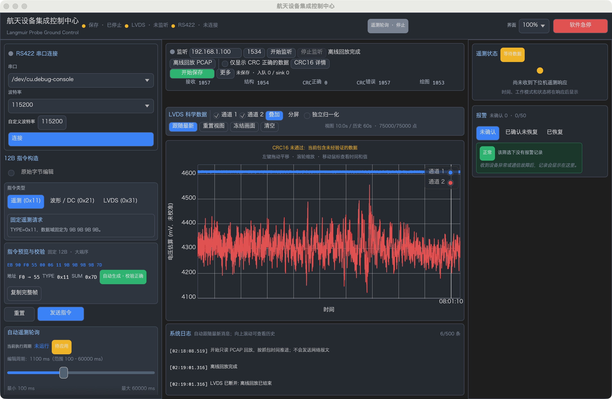
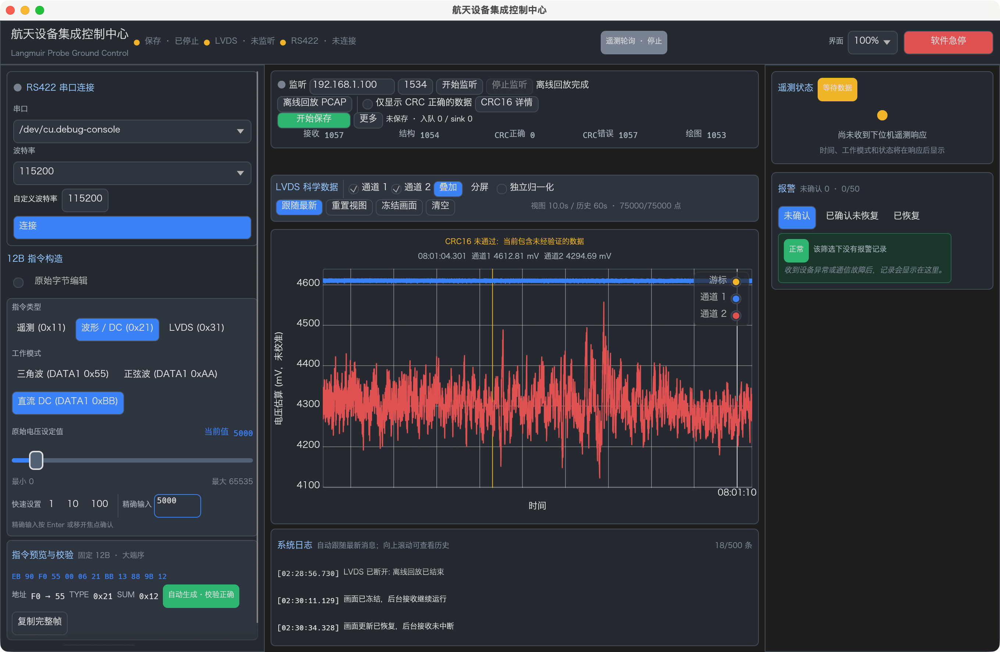
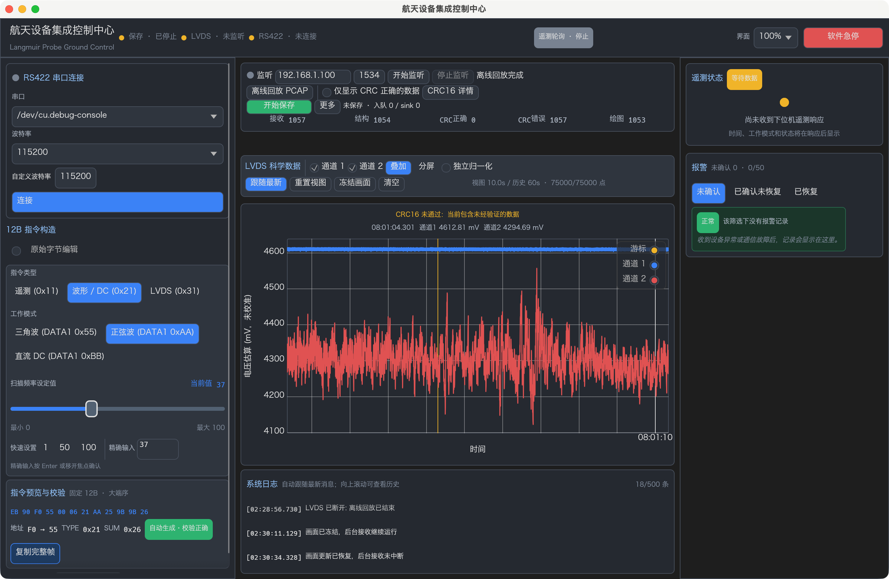

# LVDS 实时波形性能、鼠标交互与参数控件验收

日期：2026-10-20。HEAD：`3c60b1d05c4e3a924953ae25528241cf59dd7603`。源码位置指本轮工作区。

**自动化回归 PASS：235 passed、0 failed、1 ignored，原 216 个测试名称及覆盖保留；用户 PCAP 专项已单独执行 PASS。正常真实后端的左键拖动、滚轮缩放、恢复跟随、分屏/冻结及参数操作已实际通过，截图见第 10 节。Release 构建 PASS。** 同条件测量显示重绘回调更密集、绘图准备中位数下降，但准备及 update 的 p95 上升、CPU 占用上升，不能宣称全面提速或已测得屏幕 60FPS。严格 workspace Clippy 仍为 FAIL。

状态：`PASS` 为实际通过；`FAIL` 为实际失败；`BLOCKED` 为环境阻断；`NOT_RUN` 为未执行。

## 1. 修改前原因与证据

开始时执行 `git status --short` 和 `git diff --stat`，当时累计为 22 个已跟踪修改文件、4800 insertions / 571 deletions，另有前阶段未跟踪模块、报告、截图及 PCAP。本轮对照快照为 `/private/tmp/langmuir-interaction-baseline.AQXHp1/source`；没有把前阶段累计差异当成本轮独立修改。

| 问题 | 修改前源码事实与影响 |
| --- | --- |
| 实时视觉更新不连续 | 活跃科学数据时 `update()` 仅请求每 50ms 重绘，即定时请求约 20Hz；接收与画面更新节奏接近，鼠标交互缺少更频繁的画面刷新。实际帧间隔仍须以测量为准，不能由此直接宣称实际 FPS。 |
| 重复绘图数据复制 | `current_plot_points()` 调用两路 `decimated()` 返回新 Vec；`plot_panel()` 又为游标复制两路 Vec，并为图线准备拥有所有权的数据。即使增量包络已缓存，未变化画面仍有重复分配和复制。 |
| 无法左键拖动 | 叠加及两个分屏 Plot 都明确设置 `.allow_drag(false)`。没有 FollowLatest / ManualView 状态，也没有统一的手动时间范围。 |
| 看不到 CRC 失败波形上的游标读数 | 原固定提示行先显示 CRC 警告，再通过 `else if` 显示游标；当前 PCAP 一直有警告，因此游标数值被遮蔽。 |
| 频率 37 被改为 40 | 默认频率步长为 10，Slider 使用 `.step_by(10)`。egui 0.35 的 Slider 每帧执行默认 Always clamping，并在 `set_value()` 中按 step 取整；即使不拖动，精确输入也会在下一帧被修改。 |
| 非法频率没有清楚拒绝 | 原 `DragValue<u8>` 通过浮点解析与范围夹紧处理输入，没有独立草稿和确认状态，不能明确拒绝小数、越界等输入。 |
| DC 只见孤立滑块 | DC 分支只用 `add_sized()` 放大外框，没有像频率控件那样设置内部 `spacing.slider_width` 与轨道高度；轨道颜色接近卡片背景。外部 Widget Rect 宽不等于内部轨道宽。 |
| 控制区排列不稳定 | 原多处 `horizontal_wrapped()` 依赖内容自然换行；长状态、计数和窄窗口容易改变行高，缺少明确的功能行。 |

实际依赖为 `egui_plot 0.36.0`、`egui/eframe 0.35`；修改依据当前依赖 API，不套用其他版本接口。性能原因分为上述可定位的开销和后文的实测结果，没有将源码推断当作 CPU 或延迟测量。

## 2. 绘图数据准备与接收边界

`TimeSeriesBuffer::prepare_visible()` 按当前时间范围二分查找可见样本，再使用增量 min/max 包络准备显示点。放大到较小范围时直接使用原窗口内样本；宽范围使用已维护的峰谷摘要，并读取边缘被裁切桶内的原样本。进一步按显示预算保留峰谷及首末点，不用等间隔抽点掩盖尖峰。

缓存键包含可见范围、首末样本、有效样本身份与数量、显示预算及归一化状态。未变化重绘直接复用 `Vec<PlotPoint>`；新数据在手动视图范围之外时也不重建该视图。清空、年龄/容量裁剪、设备时间回退、同时间戳样本替换、缩放/平移、窗口尺寸和归一化变化均有对应失效处理。

生产绘图使用 `PlotPoints::Borrowed` 借用可见点；不再为每次绘图、游标和 Line 重复复制两路数据。游标通过原历史二分寻找最近值，显示原 ADC 转换后的电压估算，不读取归一化或抽稀后的伪值。

每路显示预算为实际绘图区物理像素宽度的约两倍，限制在 128–2000 点；实际生成数量可更少。活跃时请求每 16ms 重绘、空闲时 250ms。该节奏只影响 UI 重绘，不改变后台 UDP、PCAP 时序、LVDS 解码或正式保存的样本数量。后台和显示仍通过原有有界通道交付，原显示过载计数保留。

科学保存继续使用原 Accepted → Controller → BatchWriter → Binary/HDF5 sink；没有从图表、峰谷缓存或显示抽稀结果构造科学文件。CRC 不合格但可解码的帧继续只绘图并保留 `CrcUnverified` 来源质量，不进入正式 writer。

## 3. 历史、可见窗口、冻结与内存

| 对象 | 本轮准确行为 |
| --- | --- |
| 原 UI 历史 | 按设备时间只保留最近 10 秒；声明容量为每路 1,100,000 点，不表示已实际分配该数量。 |
| 新 UI 原历史 | 每路最多 150,125 点，并按设备时间裁掉 60 秒以前的数据。20 帧/秒、每帧 125 点时约 150,000 点。 |
| 默认可见窗口 | 最近 10 秒；与 60 秒历史和文件保存时长分别定义。 |
| 手动窗口 | 拖动/缩放后的范围持续保持；可以浏览仍在历史缓存内的数据。超出已保留历史的部分为空，不伪造数据。 |
| 显示点 | 每路最多 2000 点，同时受实际绘图区宽度和可见范围约束。 |
| 冻结 | 点击时一次性复制两路有界历史及质量状态。后台继续接收；快照不会被新数据或 live 历史裁剪改变，可继续平移、缩放。恢复更新后显示 live 历史，跟随/手动状态独立保留。 |
| 来源、过滤或清空边界 | 清理旧历史、冻结、游标及绘图计数，恢复 FollowLatest，避免混合旧来源及质量标签。 |
| 文件长度 | 按原正式保存生命周期决定，不受 10 秒视窗或 60 秒 UI 历史限制。 |

本机测试确认 `size_of::<SamplePoint>() == 24`。新原历史预分配为每路 `150125 × 24 = 3,603,000B`，双路 `7,206,000B`，约 **6.87MiB**；冻结额外复制双路原样本时，原样本合计上界约 **13.74MiB**。增量包络、可见点、分配器、字体、日志和 GPU 资源另外占用空间，不能把上述原样本字节数当作进程 RSS。

冻结复制是一次性有界操作，正常重绘借用显示缓存。60 秒历史较原 10 秒历史保留更多数据，这是支持回看功能的明确内存成本；不能宣称所有场景下 RSS 均下降。实际内存和 CPU 对比见第 4 节；连续完成三轮回放，没有以此冒充长时压力基准。

本 PCAP 结束时每路历史为 **75,000 点**，并非少接收了候选。用生产 PCAP reader 和 buffer 独立核对，第 453 个可绘候选的设备时间从 `40.199966` 回退到 `40.124982`，第 454 个又回退到 `20.149983`；原有 buffer 时间倒退清历史规则继续生效。第 454 至 1053 个候选共 `600 × 125 = 75000` 点，设备时间跨度约 50.199583 秒，小于 60 秒。累计绘图仍为 1053 帧、每路 131625 点。由于这些帧 CRC 全部失败，不能据此判定真实设备发生时钟复位。

## 4. 修改前后性能测量

修改前后均使用本机 **debug、正常真实后端、1360×860、UI 100%、Retina 2×、同一 PCAP 原速 1×、叠加跟随视图**，应用保持前台并设置 AppSleepDisabled。采用首轮回放累计绘图帧 `300..899` 的区间，排除启动和首段字体预热；之后多轮回放不混入首轮性能统计。修改前后原始记录分别为 [BEFORE.csv](qa/LVDS_PLOT_PERF_BEFORE.csv) 和 [AFTER.csv](qa/LVDS_PLOT_PERF_AFTER.csv)，分位数使用 nearest-rank。修改后计时二进制尚不含最后的“手动视图切换归一化时重新拟合 Y”修复；该分支在本计时场景未启用，最终 Release 已另行实测归一化切换。

可选 `LANGMUIR_PLOT_MEASUREMENTS` 指定 CSV 路径。关闭时写出每次 egui `update()` 回调的耗时、绘图准备耗时、两路缓存点、实际显示点及累计绘图帧；最多记录 30,000 行，正常未设置时不收集。该计时不包含 GPU 呈现或操作系统合成，也不自动等于显示器实际 FPS。CPU、RSS、交互延迟须另行实测，不从这些字段推算未测事实。

| 相同测量区间的指标 | 修改前 | 修改后 |
| --- | --- | --- |
| 区间回调样本数 / 区间耗时，s | 1071 / 30.261213 | 2351 / 30.089581 |
| GUI update 耗时 p50 / p95 / 最大值，ms | 2.635458 / 4.869833 / 30.667333 | 2.451833 / 5.489209 / 10.408625 |
| 绘图准备耗时 p50 / p95 / 最大值，ms | 0.095417 / 0.351292 / 0.485500 | 0.008458 / 0.636958 / 1.174125 |
| UI 回调次数 / 秒，非屏幕 FPS | 35.358794 | 78.100124 |
| UI 回调间隔 p50 / p95 / 最大值，ms | 36.711 / 39.837 / 621.633 | 10.301 / 26.013 / 47.390 |
| 每通道缓存点数中位数 / 最大值 | 24751 / 25001 | 34500 / 56500 |
| 通道 1 显示点数中位数 / 最大值 | 1984 / 2000 | 1957 / 2000 |
| 通道 2 显示点数中位数 / 最大值 | 1984 / 2000 | 1998 / 2000 |
| CSV 首次非零到最终绘图计数耗时，s | 52.775978；最终 1049 帧 | 52.715875；最终 1053 帧 |
| `ps` 每 5s 采样的 CPU 使用率 | 19.1–68.1% | 66.6–87.1% |
| 同次采样 RSS 范围，KiB | 105888–121920 | 99664–120976 |

绘图准备中位数下降约 **91%**，反映借用与不变视窗复用减少了通常重绘的准备成本；准备 p95 上升约 **81%**，update p95 也上升。新的 60 秒历史、可见范围准备及更多回调带来不同成本分布。回调间隔和最大 update 停顿改善，但本次 `ps` CPU 采样明显更高，不能写成 CPU 下降。RSS 是短测区间观测，三轮成功回放不证明长期没有内存增长。

CSV 首次非零至终值区间受回调量化影响，不能替代原捕获持续时间 **52.7979949s**；修改后生产回放日志耗时约 **52.797s**，仍按原捕获时序运行。修改前 CSV 最终绘图 **1049**，修改后 **1053**，如实保留这 4 帧差异，不能只凭 CSV 判定其原因。完整 UDP 1057 及当前逐包/绘图核对见第 8 节；本轮没有用减少接收量优化画面。

原生左拖事件投递 epoch `1792434080.557` 至首条 ManualView 日志约 `1792434080.610`，一次测得 CPU 处理响应约 **53ms**。这是单次事件到状态日志的响应，不是像素呈现延迟或 p50/p95。视图状态日志见 [INTERACTION.txt](qa/LVDS_PLOT_INTERACTION.txt)。没有 GPU 呈现或屏幕 FPS 测量，不能用约 78 次/秒 UI 回调宣称屏幕超过 60FPS。

## 5. 鼠标、跟随和冻结交互

主图使用左键原生拖动平移 X/Y。无修饰键滚轮围绕鼠标缩放，保留原生缩放输入；鼠标移动更新时间及两路原值。质量提示和游标各保留固定行，CRC 未验证提示不再遮挡读数或移动图表位置。

初始为 FollowLatest。用户拖动或缩放进入 ManualView，持续接收新帧不会抢回最新范围。“跟随最新”和“重置视图”恢复最近 10 秒与默认纵向范围。分屏共用时间范围，两路时间轴同步；各自的 Y 轴由相应图表管理。冻结快照与跟随状态独立，冻结时也能浏览和缩放快照。

自动化指针/滚轮测试已通过：左拖后手动范围保持、新样本不抢视图、滚轮缩放、CRC 提示下游标更新、分屏 X 同步、冻结不受新数据影响，以及归一化切换重新拟合 Y 轴并保持手动时间范围。下表则是 **正常真实后端原生窗口的实际鼠标操作**，与自动化结果分别记录。

| 原生真实后端操作 | 结果 / 实际范围证据 |
| --- | --- |
| 默认回放直接出现双通道波形 | PASS：正常后端回放，无需切换诊断视图；双路候选与 CRC 警告直接显示 |
| 左键拖动，时间范围确实改变 | PASS：叠加图进入 ManualView，X 范围变为 `[18.099277, 28.099277]` |
| 手动视图继续接收，范围不跳回 | PASS：上述范围在后续新数据到达时保持 |
| 滚轮放大、缩小 | PASS：原生滚轮正反各 4 格；实测 `[60.349566,70.349566]` 缩至 `[63.036312,67.529602]`，反向后恢复约 10s |
| 点击跟随最新，恢复持续跟随 | PASS：实际点击后回到 FollowLatest；截图记录恢复后的波形 |
| 分屏关键拖动、缩放和跟随 | PASS：实际左拖后范围 `[59.015163,69.015163]`，滚轮正反各 3 格，并实际恢复跟随；两路 X 同步 |
| 冻结后关键拖动、缩放与稳定快照 | PASS：冻结分屏后实际左拖与滚轮 2 格，范围缩至 `[61.030516,67.733718]`，快照保持 |
| 移动鼠标显示时间和两路数值 | PASS：CRC 警告与游标读数使用固定的独立行；原值与归一化行为另有自动化回归 |

## 6. DC Slider 与频率精确输入

两类参数复用同一个水平轨道实现：轨道独占一整行，内部 `slider_width` 明确跟随父卡片宽度，轨高 6pt；蓝色已选区域、灰蓝色剩余轨道及明确滑块边框沿用主题。标题与当前值、滑轨、最小/最大范围、快速设置与精确输入分别布局；不足 260pt 时明确将预设和输入拆成两行，不依赖随机换行挤压轨道。

频率与 DC 各有独立 `IntegerParameterEdit`，保留文本草稿、是否待确认及错误。Enter 或失焦确认成功才更新参数；字符、负数、小数、空输入、越界明确拒绝并显示错误，不静默夹紧或取整。相关输入非法或尚未确认时，typed 预览和发送均被阻断。Slider 使用整数步长 1 并关闭 smart aim，拖动或实际点击预设后同步文本；预设只在点击时生效。

频率继续使用 TYPE `0x21`、三角 DATA1 `0x55` / 正弦 `0xAA`、DATA2 整数 0–100；DC 继续使用 `0xBB` 及原大端 u16，不增设物理单位或缩窄厂家未确认范围。原 Command 编码和 SUM 算法未改。

| 自动化参数检查 | 实际结果 |
| --- | --- |
| 三角和正弦分别输入 1、20、37、50、73、99、100 | PASS：多次闲置重绘后数值、文本与 DATA2 均原样保持 |
| 真实 TextEdit 输入 37、Enter；再输入 99、失焦 | PASS：提交前保留旧确认值，提交后准确同步 |
| 37.5、负数、101、非法字符等输入 | PASS：明确报错，不生成或发送旧参数指令 |
| 实际拖动 Slider 到 37 | PASS：不吸附到 40，后续重绘不改值 |
| 点击频率预设 1 / 50 / 100 | PASS：只在点击时改变值并同步文本、DATA2 |
| 正弦 37 的预览、SUM、点击发送请求数组 | PASS：`EB 90 F0 55 00 06 21 AA 25 9B 9B 26` |
| DC 0、1、5001、32769、65535 | PASS：不按旧 100 步长取整，大端字节和 SUM 正确 |
| DC 真实绘制的轨道 Shape | PASS：180、224、284、344pt 宽度均有完整水平轨道，无孤立滑块 |

原生参数验收同样通过。DC 从初始 5000 实际拖到 **36800**，完整水平轨道可见；再精确输入 **5000**，滑块同步，HEX 数据恢复为 **13 88**。三角和正弦分别逐项输入 **1、20、37、50、73、99、100**，实际点击“复制完整帧”读取字节，确认 DATA2 与 SUM；正弦 37 完整帧与上述黄金字节一致。`37.5`、`101`、`abc` 原生输入均显示红色错误并禁用发送，截图见第 10 节。实际发送数组仅用自动化 backend 请求队列验证，没有向真实串口发送任何控制指令。

以下为原生界面实际复制出的字段，均为十六进制：

| 输入整数 | DATA2 | 三角 SUM | 正弦 SUM |
| --- | --- | --- | --- |
| 1 | 01 | AD | 02 |
| 20 | 14 | C0 | 15 |
| 37 | 25 | D1 | 26 |
| 50 | 32 | DE | 33 |
| 73 | 49 | F5 | 4A |
| 99 | 63 | 0F | 64 |
| 100 | 64 | 10 | 65 |

## 7. LVDS 控制区与窗口布局

中央 136pt 操作区按监听端点与状态、回放/CRC 检查、正式保存、五项质量计数分行。宽度不足时使用明确的监听/回放紧凑行；长状态与超大计数可截断并通过 hover 查看，不让自然换行增加模块高度。保存展示继续区分入队、sink 写入、关闭和错误，不把出现波形当成落盘成功。

固定三栏、中央无整体滚动、图表填充剩余空间、底部 160pt 日志和 68pt 图表工具栏保持。质量提示和游标行预留空间，数据到达、CRC 警告及冻结不会使图表/日志上下跳动。

| 指定窗口 / UI 缩放 | 实际 themed egui 几何测试 | 原生窗口视觉结果 |
| --- | --- | --- |
| 1360×860 / 100% | PASS | PASS：正常 debug 回放/参数操作及最终 Release 窗口截图 |
| 1600×900 / 100% | PASS | PASS：[最终 Release](qa/LVDS_PLOT_RELEASE_1600.png)，两路曲线、完整参数轨道及控制按钮可见 |
| 1280×720 / 125% | PASS | PASS：[最终 Release](qa/LVDS_PLOT_RELEASE_1280_125.png)；[左栏滚动后的 DC 轨道](qa/LVDS_PLOT_RELEASE_1280_125_PARAMS.png) |

上述尺寸均指客户区，macOS 外框额外包含 28pt 标题栏。1280×720 / 125% 下使用紧凑控制区和显示模式菜单，图表随剩余空间缩小并隐藏坐标轴；固定日志保留，因此此尺寸的曲线观察高度明显少于默认窗口。参数使用原有左侧独立滚动区查看，中央没有整体滚动。最终以显式清零修饰键的原生滚轮事件复核，UI 仍为 125%，图表视窗从 10 秒缩到约 4.5 秒。

几何测试覆盖无数据、运行和冻结、叠加与分屏、长错误状态及 u64 最大计数；同时检查参数卡片、非法输入提示和实际水平轨道不越出父卡片。它证明控件几何边界，不替代以上原生视觉操作。

本轮采用 [ui-ux-pro-max](/Users/lingyuancong/.codex/skills/ui-ux-pro-max/SKILL.md) 已读取的原生控件、就近错误反馈、可辨识状态、稳定布局及大数据图表指导，沿用现有工业主题。技能附带 scripts 路径为失效文本，实际搜索脚本缺失；没有声称运行其设计搜索，也未安装或重建无关技能。

## 8. 用户 PCAP 与科学保存边界

原件 `2026101902--朗缪尔.pcapng`，389712B。前后 SHA-256 保持：

```text
5937b2da0cc833946bc082c03f9ea9c1ab1424427769c4a071ed893ead50eb2f
```

专项实际读取该文件，仍经 PCAPNG → 原 24B UDP → 原重组 → 269B 严格/候选检查 → Controller → 图表事件；没有改原始字节、位移纠偏或用 Mock 替换真实包。回放按原捕获间隔，正常来源过滤不变。

| 实际专项结果 | 默认允许候选绘图 | 严格 CRC 过滤 |
| --- | ---: | ---: |
| PCAP 总包 / 匹配 UDP / 完整候选 | 1059 / 1057 / 1057 | 1059 / 1057 / 1057 |
| 结构合法 | 1054 | 1054 |
| CRC 正确 / 错误 | 0 / 1057 | 0 / 1057 |
| 可解码未验证候选 | 1053 | 1053 |
| 绘图事件 | 1053 | 0 |
| 每通道累计采样点 | 131625 | 0 |
| 正式 Accepted / writer 入队 / sink 写入 | 0 / 0 / 0 | 0 / 0 / 0 |
| 关闭重开后的科学记录 / `.lpd` 长度 | 0 / 32B | 0 / 32B |

3 个头错误与 1 个次级时间错误不强行绘图。分类可重叠，CRC 错误包含头错误；131625 是累计收到的每路采样，不是默认 10 秒视窗内同时渲染的点数。两个非目标包保留在 PCAP 总数中。CRC 全部失败的硬件/固件原因仍未确认，本轮未改 CRC 质量含义。

## 9. 测试、构建与 Clippy

| 实际命令 | 结果 |
| --- | --- |
| `cargo fmt --all -- --check` | PASS |
| `cargo check --workspace --locked` | PASS |
| `cargo test --workspace --features langmuir-desktop/mock --locked` | PASS：235 passed、0 failed、1 ignored；core 89 / desktop 107 / CLI 5 / storage 9 / transport 25 |
| `cargo test -p langmuir-desktop --features mock --locked e7_user_capture_strict_and_diagnostic -- --ignored --nocapture` | PASS：真实用户 PCAP 专项 |
| `cargo build --release -p langmuir-desktop --locked` | PASS：最终构建 7.24s，包含最新归一化视图修复；正常真实后端，未启用 mock feature |
| `cargo clippy --workspace --all-targets --locked -- -D warnings` | FAIL：既有 framing / CLI / storage lint |
| 既有 lint 分离诊断，含 Mock | PASS：不替代上一行严格 FAIL |
| PCAP 原件前后哈希 | PASS：一致 |

原 216 个测试名称全部保留。新增 19 项包括参数 9、图表指针/滚轮/冻结/归一化 4、指定窗口布局 2、可见缓存/峰谷/质量/内存/失效 4。严格 CRC、269B、两路各 125 点、UDP TTL、去重、P1-3、RS422 六条黄金指令、`.lpd` 存储及原 400 帧测试回归保持通过。

严格 Clippy 的既有错误包括 `framing.rs` 的 `assert_is_empty`、CLI 的 `chunks_exact_to_as_chunks` 和 storage 的 `explicit_iter_loop`。沿用已知 allow-list 的分离诊断通过；其中 `too_many_lines` 也抑制本轮新增 `prepare_visible()` 的长函数诊断，不能把所有被抑制项称为既有问题，也不能把该诊断 PASS 当作严格 Clippy 通过。没有新增全局 lint 禁用；局部 `expect` 对受限显示预算的数值转换等具体理由作注释，不放宽协议校验。

## 10. 原生截图和实际操作范围

正常真实后端 debug 窗口通过原生鼠标事件实际点击、拖动及滚轮操作，1360×860 / 100%，未启用 Mock。三轮 PCAP 原速回放均完成；真实 GUI 参数测试包括逐项输入及“复制完整帧”读取校验，没有发送串口指令。最终重新以最新 Release 正常后端启动，实际回放完成 1053 帧，并保存 [Release 窗口截图](qa/LVDS_PLOT_RELEASE_1360.png)；实际切换归一化后两路仍在可见 Y 范围内，见 [归一化截图](qa/LVDS_PLOT_NORMALIZED.png)。下列全部为真实应用窗口截图，不是 headless 或 Mock 图片。

| 本轮要求的真实截图 | 路径与实际结果 |
| --- | --- |
| PCAP 双通道波形 | PASS：[LVDS_PLOT_PCAP.png](qa/LVDS_PLOT_PCAP.png) |
| 拖动后的 ManualView | PASS：[LVDS_PLOT_MANUAL.png](qa/LVDS_PLOT_MANUAL.png) |
| 缩放后的波形 | PASS：[LVDS_PLOT_ZOOM.png](qa/LVDS_PLOT_ZOOM.png) |
| 恢复实时跟随 | PASS：[LVDS_PLOT_FOLLOW.png](qa/LVDS_PLOT_FOLLOW.png) |
| 冻结后的可缩放双通道快照 | PASS：[LVDS_PLOT_FROZEN.png](qa/LVDS_PLOT_FROZEN.png) |
| DC 完整水平轨道 | PASS：[LVDS_PLOT_DC.png](qa/LVDS_PLOT_DC.png) |
| 频率 37 精确输入及黄金指令预览 | PASS：[LVDS_PLOT_FREQUENCY_37.png](qa/LVDS_PLOT_FREQUENCY_37.png) |
| 非法频率、红色错误和禁用发送 | PASS：[LVDS_PLOT_FREQUENCY_INVALID.png](qa/LVDS_PLOT_FREQUENCY_INVALID.png) |







本轮创建的 debug 测试进程 75954 与最终 Release 测试进程 78230 均已正常退出；`ps` 核对原有用户进程 71160 仍保留。没有自动连接设备、发送 RS422 或改变硬件控制行为。

## 11. 工作区保护、交付与未执行范围

| 本轮源码/测试文件 | 职责 |
| --- | --- |
| `apps/desktop/src/app.rs` | 借用可见点、跟随/手动/冻结、参数精确输入、DC 轨道、控制区固定分组及测量接入 |
| `apps/desktop/src/buffer.rs` | 60 秒有界历史、可见窗口复用、峰谷显示、质量/游标与失效测试 |
| `apps/desktop/src/main.rs` | 注册可选测量模块 |
| `apps/desktop/src/perf.rs`（新增） | 显式启用的本地 GUI CSV 测量 |
| `apps/desktop/src/app_parameter_tests.rs`（新增） | 参数交互、黄金字节、轨道实际 Shape 与发送边界 |
| `apps/desktop/src/app_plot_tests.rs`（新增） | 拖动、缩放、手动保持、分屏和冻结 |
| `apps/desktop/src/app_layout_tests.rs`（新增） | 指定尺寸/缩放的真实 themed egui 控件边界 |
| 本报告、`docs/qa/LVDS_PLOT_*.png`、两份性能 CSV 及视图状态日志 | 实际证据与限制 |

`backend.rs`、`bridge.rs`、`theme.rs` 与协议、transport、storage、CLI、Cargo 文件均未因本轮改动。CRC 算法和 `[7..267]`、269B、24B UDP、差分恢复、2 秒 TTL、5 秒/256 去重、P1-3、RS422 和 `.lpd` / HDF5 schema 保持。旧报告、截图、用户原 PCAP 及此前未提交修改保留。没有 Git 提交、重置、清理、删除用户文件或推进 P1-4。

当前累计 tracked diff 为 **22 个文件、6052 insertions、1040 deletions**，包含此前阶段，不能当成本轮独立差异；新增未跟踪文件也不计入该数。本轮独立源码/测试清单见上表。

最终逐文件 `cmp` 核对开始快照的 **76 个文件**：73 个字节完全一致，仅 `app.rs`、`buffer.rs`、`main.rs` 三个预期源码变化；另新增上表的 4 个 UI 测试/测量文件及本轮证据。`crates/`、`tools/`、Cargo.toml、Cargo.lock、既有文档与截图均与开始快照一致，原 PCAP 哈希一致。最终 `git diff --check` 通过，累计 tracked 统计再次核对为上面的 22 / 6052 / 1040，没有提交 Git。

真机 UDP、真实串口控制、厂家 CRC 根因、HDF5 feature 实机运行、长时真机落盘与性能不属于本轮已通过项。正式文件仍要求原严格 Accepted，图表和测量结果不构成落盘或断电持久化承诺。

正常启动：

```bash
cargo run --release -p langmuir-desktop --locked
```

默认保持“仅显示 CRC 正确的数据”未勾选，选择用户 PCAP 并开始回放。图表提供左键拖动、滚轮缩放、“跟随最新”和“重置视图”；本阶段完成后停止，不继续其他功能。
