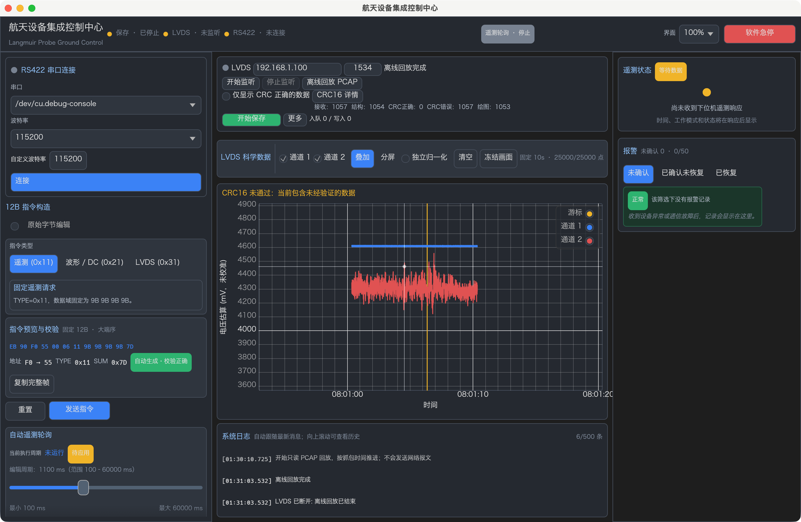
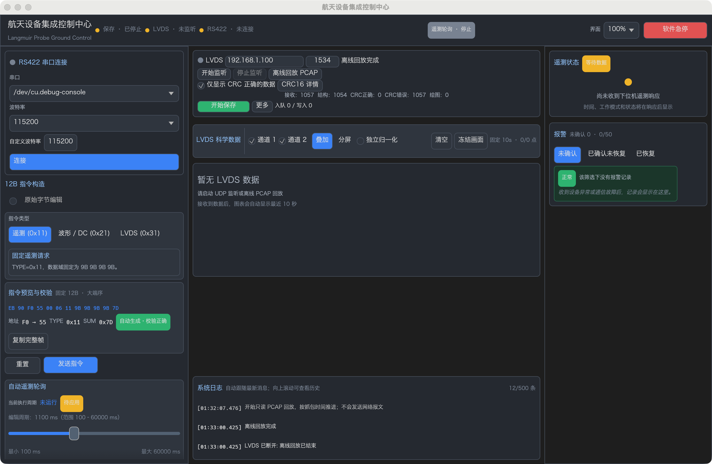

# LVDS 简化绘图准入与 PCAP 回放验收

日期：2026-10-20。HEAD：`3c60b1d05c4e3a924953ae25528241cf59dd7603`。行号指当前工作区。

**PASS：正常启动后，点击“离线回放 PCAP”，核对路径并点击“开始回放”，中央图表直接显示两路候选波形。默认不勾选“仅显示 CRC 正确的数据”，无需诊断确认或波形来源切换。** 实际用户 PCAP 默认绘图 **1053 帧，每通道 131625 点**；严格过滤绘图 **0 帧**。两种情况下 CRC 正确均为 0、CRC 错误均为 1057，正式科学记录均为 0。

最终 Mock workspace：**216 passed、0 failed、1 ignored**；该 ignored 为用户 PCAP 专项，本轮已单独执行 PASS。此前 206 项覆盖保留，新增 10 项默认回归。真实桌面默认回放、严格过滤回放和退出重启均实际操作并截图。严格 workspace Clippy 仍为 **FAIL**，没有将放宽诊断称为严格通过。

状态：`PASS` 为实际通过，`FAIL` 为实际失败，`BLOCKED` 为环境阻断，`NOT_RUN` 为本轮未执行。

## 1. 原因与修改边界

此前默认严格模式，CRC 失败候选需要确认启用诊断，再选择独立诊断波形。用户 PCAP 的 CRC 全部不匹配，因此默认图表无数据，即使其中 1053 帧已能合法恢复时间与两路 ADC。

本轮复用 `diagnose_scientific_frame()`、`UnverifiedScientificFrame`、ScienceGate、PCAPNG reader 和原图表；没有修改 core、transport、storage 或 CLI 源码。CRC 算法、覆盖 `[7..267]`、269B 科学帧、24B UDP、差分算法、2 秒 TTL、5 秒/256 FIFO 去重、P1-3、RS422、文件格式及 Cargo.lock 全部保持。

本轮只改变绘图准入与对应 UI，未进入 P1-4 包络、Reader、Sidecar、诊断导出或文件版本升级。

## 2. 新准入与实际数据链

| 输入 | 默认未勾选过滤 | 勾选严格过滤 | 正式保存 |
| --- | --- | --- | --- |
| CRC 合格，结构、时间、ADC 合法 | Accepted 后绘图 | Accepted 后绘图 | 仅正在保存时进入原 writer |
| CRC 失败，其余全部合法 | 绘图，逐点标为 `CrcUnverified` | 不生成候选绘图事件 | 始终不进入正式 writer |
| 帧头、地址、类型、长度、时间或 ADC 非法 | 不绘图 | 不绘图 | 不保存 |
| 合法同序号重复或冲突 | 原去重规则抑制 | 原去重规则抑制 | 原规则不变 |

CRC 仍对每个完整候选计算，包括结构错误的完整 269B 候选；CRC 相等只说明两个校验值相等，不等于其他字段合格或正式 Accepted。没有修改字节、重算覆盖字段以冒充实收 CRC，也没有 bit 位移纠偏。

`backend.rs:580` 的 `UdpLvdsIngress::inspect_complete()` 复用原诊断接口记录 CRC 和各类错误；只有其 `preview` 存在且允许候选绘图时，才创建 `DiagnosticSamples`。原严格 `science_gate.accept_at()` 继续独立执行，只有 Accepted 推进去重后的 P1-3 观察及正式 handler。

`backend.rs:454` 的 `push_delivery_at()` 每个数据报处理后立即取出候选；生产 UDP 与回放共用 `LvdsDelivery::{Accepted, Unverified}` 保持交付顺序，避免原来单个待显示候选在一批 UDP 中被覆盖，以及先交付全部合法帧再交付全部错误 CRC 帧的顺序错配。该枚举仅用于当前 Controller 交付，不是 P1-4 存储包络。

`Controller::handle_lvds_delivery()`（`backend.rs:1681`）将 Accepted 交给原 `handle_scientific_frame():1723`，将 Unverified 仅交显示通道。**未验证事件不调用正式科学 handler，不进入 `BatchWriter<ScientificFrame>`。** 过滤在保存期间也可切换（`set_diagnostic_preview():1005`）；存储失败处理不回滚去重或监测状态。

`publish_lvds_status():1128` 在生产端的来源/过滤边界清理旧视觉队列，再发布状态，修复原桥接层收到状态后可能连同新来源首帧一起清除的问题。普通同来源状态刷新与正常 EOF 不清除已产生的新绘图事件。

## 3. 统一图表、质量标记和计数

`app.rs:2156` 的 `crc_controls()` 直接显示复选框和可选 CRC 详情，没有诊断确认弹窗。`operations_panel():2022` 提供监听、停止及直接 PCAP 回放入口；`replay_dialog():2251` 使用可编辑路径框，默认填入工程内用户 PCAP 文件名，点击“开始回放”即可。通道、叠加/分屏、冻结、清空和固定 10 秒窗口继续使用同一工具栏。

`app.rs:759` 的 `handle_diagnostic_event()` 与合法样本进入同一对图表缓存，但使用不同质量标记。`buffer.rs:4` 的 `SampleQuality` 和 `SamplePoint.quality` 保留逐点来源质量；两路混合显示不将未验证点改成 Accepted。原始缓存按年龄及容量有界，渲染仍用每路最多 2000 点的既有包络下采样。

`TimeSeriesBuffer` 同时维护当前窗口未验证点数：容量裁剪、年龄裁剪、清空、设备时间回退都会维护标记。冻结快照单独保存质量说明，避免后台窗口裁剪后把冻结的未验证波形错误标成合格。图表预留固定说明行，包含未验证数据时显示“CRC16 未通过：当前包含未经验证的数据”，不通过闪烁提醒；顶栏新数据状态使用“波形更新”，不宣称 CRC 已通过。

过滤切换、来源切换及清空均清除旧两路缓存、冻结、游标和绘图计数，后续新事件直接进入同一图表，无需选择类型。复选框提示及日志说明这一规则。`set_crc_filter():518` 仅在请求成功发送后更新本地状态；请求队列满或断开时保留原设置和此前待确认请求，并报告错误。待确认期间不会被旧状态快照重新开启严格视图中的错误 CRC 准入。

计数含义如下；各计数不要求互斥，也不是落盘成功计数：

| 界面/字段 | 含义 |
| --- | --- |
| 接收 / `udp_packets` | 匹配来源的 UDP 报文，包括分片与错误外层；其他来源不进入该数 |
| `complete_frames` | 完整重组候选，CRC 详情可查 |
| 结构 / `structure_valid_frames` | 帧头、长度及固定字段合格；后续时间或 ADC 仍可能失败 |
| CRC正确 / CRC错误 | 实收 CRC 与原范围计算值相等 / 不等，不冒充科学 Accepted |
| `diagnostic_candidates` | CRC 错误且其他全部合法的候选；严格过滤时也保留该统计 |
| 绘图 | 当前来源/过滤/清空区间内，UI 实际消费并准入缓存的帧事件；冻结期间接收仍计数 |
| 入队 / sink写入 / 关闭 | 原正式保存状态，各阶段分开；均不由绘图或 Accepted 推算 |

后端统计每 500ms 刷新，绘图计数随事件更新，回放进行中可暂时看到不同采样时刻的数字；回放完成截图使用最终状态。显示通道仍有界，过载丢弃继续单独计数，不承诺任意压力下显示全部包。

## 4. 用户 PCAP 实际结果

文件：`2026101902--朗缪尔.pcapng`，389712B。前后 SHA-256 一致：

```text
5937b2da0cc833946bc082c03f9ea9c1ab1424427769c4a071ed893ead50eb2f
```

E7 使用实际文件后台 `PcapReplay` → 原 ingress → Controller → 显示事件与真实 BinarySink。另逐包独立核对结构、CRC 和时间/ADC，结果由运行读取获得，没有将旧报告数字当作输出。自动化专项仅推进回放时钟以避免等待；真实 GUI 则按原捕获间隔回放，两次均正常完成约 52.8 秒。

| 实际指标 | 默认绘图 | 严格过滤 |
| --- | ---: | ---: |
| PCAP 总包 | 1059 | 1059 |
| 匹配来源 UDP / 完整候选 | 1057 / 1057 | 1057 / 1057 |
| 结构合法 | 1054 | 1054 |
| CRC 正确 / 错误 | 0 / 1057 | 0 / 1057 |
| 可解码未验证候选 | 1053 | 1053 |
| 头错误 / 次级时间错误 | 3 / 1 | 3 / 1 |
| 正式 Accepted / 合格波形事件 | 0 / 0 | 0 / 0 |
| 未验证绘图事件 | 1053 | 0 |
| 通道 1 / 通道 2 累计采样点 | 131625 / 131625 | 0 / 0 |
| 正式 writer 入队 / sink写入 | 0 / 0 | 0 / 0 |
| 关闭重开后的科学记录 / 文件长度 | 0 / 32B | 0 / 32B |

两包非目标 UDP 仍计入 PCAP 总包。结构合法的 1054 帧中有一帧时间非法，因此可绘图为 1053。错误分类存在重叠：1057 次 CRC 不等包含 3 个头错误；原严格错误计数仍遵守头错误先于 CRC 的顺序。ADC 检出错误为 0 不代表被提前拒绝的结构/时间错误帧也完成了 ADC 检查。

131625 是累计每路事件采样点数，不是同时常驻缓存点数。真实窗口结束时每路保留约 25000 点的最后 10 秒窗口，并下采样显示。PCAP 不合格的 CRC 和其硬件/固件原因没有因能够绘图而得到确认或修复。

## 5. 真实 GUI 操作与截图

**PASS：使用 `cargo run -p langmuir-desktop --locked` 正常后端启动，未带 `--mock`。** 实际通过 macOS 原生鼠标事件点击“离线回放 PCAP”及“开始回放”，路径框使用工程 PCAP；关闭回放设置窗口后中央直接出现蓝色通道 1、红色通道 2 及未验证提示。最终窗口显示接收 1057、结构 1054、CRC正确 0、CRC错误 1057、绘图 1053。

随后实际勾选严格过滤，旧波形和计数清空，再回放同一文件；最终绘图 0、两路缓存 0，CRC错误仍为 1057。退出程序后重新启动，复选框再次默认不勾选。未点击监听、串口连接或发送控制指令。测试进程已正常关闭。

默认回放完成截图：



严格过滤完成截图：



两张均截取真实应用窗口，不使用 Mock 或 headless 图片代替。原生验收范围为上述两条回放路径及重启；没有宣称完成每个按钮的原生人工验收、长时性能基准或真机验收。冻结、混合质量、来源切换及窄窗口几何另有自动化覆盖。

本轮采用 `ui-ux-pro-max` 的原生控件、文字质量提示和稳定布局指导；技能附带 scripts 是失效路径文本，未运行其设计搜索脚本，使用已读取的静态指导并沿用原主题。固定三栏、中央无整体滚动、图表弹性区域及底部日志停靠保持。

## 6. 自动化验收与命令

| 场景 | 本轮结果与证据 |
| --- | --- |
| T1 默认用户 PCAP | PASS：实际后台回放、两路事件、独立逐包统计及 GUI 均见上表；`backend_e2e_tests.rs:868` |
| T2 严格过滤 | PASS：同源同文件计数保留，错误 CRC 事件/采样为 0；实际 GUI 同样为 0 |
| T3 合法黄金帧 | PASS：两种过滤均绘图和保存；`backend_e2e_tests.rs:251` |
| T4 混合数据与保存 | PASS：合法、可解码 CRC 错误、非法帧准入与计数正确；真实 BinarySink 关闭重开只含合法记录，交付顺序保持；`backend_replay_tests.rs:169` |
| T5 切换/重启/来源 | PASS：直接复选框、保存期间切换、旧事件拒绝、来源清空、满请求队列/断开恢复；`app.rs:3824`、`:3847`；实际重启默认未勾选 |
| T6 连续 400 帧 | PASS：50ms 回放 CRC 错误候选 400、每路 50000 点；混合质量 400 帧进入同一 UI，两路缓存按窗口有界、下采样各不超过 2000；`backend_replay_tests.rs:97`、`app.rs:3707` |
| T7 既有协议/保存 | PASS：严格 CRC、269B、双通道、TTL、去重、P1-3、RS422 黄金指令、存储全回归；原覆盖保留 |
| 缓存/冻结质量 | PASS：年龄/容量裁剪、清空、时间回退及冻结快照不伪造质量；`buffer.rs:135`、`app.rs:3669` |
| 布局 | PASS：800×600、1120×720、1360×860 的实际 egui 控件边界、直接按钮指针操作；原生 1360×860 回放截图 |

本轮执行结果：

| 命令 | 状态 |
| --- | --- |
| `cargo fmt --all -- --check` | PASS |
| `cargo check --workspace --locked` | PASS |
| `cargo test --workspace --features langmuir-desktop/mock --locked` | PASS：216；core89 / desktop88 / CLI5 / storage9 / transport25；另1 ignored |
| `cargo test -p langmuir-desktop --features mock --locked e7_user_capture_strict_and_diagnostic -- --ignored --nocapture` | PASS：实际用户文件专项1 |
| `cargo clippy --workspace --all-targets --locked -- -D warnings` | FAIL：原 framing/CLI/storage 基线 lint |
| 已知基线 lint 分离诊断（含 Mock） | PASS：仅诊断，不替代严格 FAIL |
| `git -c core.whitespace=cr-at-eol diff --check` | PASS |
| HDF5 feature 运行测试 | NOT_RUN：本轮未改其实现/schema；上阶段原生依赖阻断记录不冒充本轮通过 |
| 真机 UDP、RS422 实发、长时落盘 | NOT_RUN |

首次沙箱内 workspace 的两个既有 localhost UDP 绑定用例因 `Operation not permitted` 失败；允许本机回环后最终完整命令通过。没有对设备建立网络连接。

严格 Clippy 的实际错误仍来自未改文件：`framing.rs:289,291` 的 `assert_is_empty`、CLI `main.rs:325` 的 `chunks_exact_to_as_chunks`、`binary.rs:143,146` 的 `explicit_iter_loop`。新测试的 Duration 单位诊断已修复，无新增全局 lint 禁用。最终分离诊断命令为：

```bash
cargo clippy --workspace --all-targets --features langmuir-desktop/mock --locked -- -D warnings \
  -A clippy::chunks_exact_to_as_chunks -A clippy::explicit_iter_loop \
  -A clippy::assert_is_empty -A clippy::too_many_lines \
  -A clippy::semicolon_if_nothing_returned -A clippy::match_result_ok \
  -A clippy::uninlined_format_args -A clippy::if_not_else \
  -A clippy::manual_clamp -A clippy::items_after_statements \
  -A clippy::assertions_on_constants
```

内存事件/缓存测试证明显示准入、质量和队列调用；实际 `.lpd` 结论来自 BinarySink 关闭重开核对。UI 出现曲线、Accepted、入队、sink API 返回和断电持久化仍是不同语义。没有增加 fsync 或新的持久化承诺。

## 7. 工作区保护与停止点

首先执行 Git status 与 diff stat，开始时是前阶段累计 21 个已跟踪修改、4493 insertions / 387 deletions，另有未跟踪模块、测试、报告和 PCAP。对开始时 71 个现有文件保存 SHA-256 与完整备份；交付前 64 个完全不变，仅以下 7 个预期文件变化：

| 文件 | 本轮职责 |
| --- | --- |
| `apps/desktop/src/app.rs` | 默认统一图表、直接过滤/回放、实际绘图计数、质量说明及UI回归 |
| `apps/desktop/src/buffer.rs` | 逐点质量与有界窗口的未验证计数 |
| `apps/desktop/src/backend.rs` | 默认候选准入、生产交付顺序、边界清理及回归 |
| `apps/desktop/src/bridge.rs` | 结构计数与默认状态语义 |
| `apps/desktop/src/mock.rs` | 合成来源默认过滤一致，继续不伪造真实 CRC 统计 |
| `apps/desktop/src/backend_e2e_tests.rs` | 用户 PCAP、合法帧、真实文件和独立统计 |
| `apps/desktop/src/backend_replay_tests.rs` | 400帧、混合顺序及保存期间过滤 |

新增本报告及 `docs/qa/` 中上述两张真实应用截图。旧报告保持原样，其默认严格/诊断操作说明属于历史版本，以本报告为当前行为说明。原 PCAP、core 全部协议实现、transport（包括 PCAPNG reader）、storage、CLI、Cargo 文件均未变。

最终累计 tracked diff 为 22 个文件、4800 insertions / 571 deletions，不代表本轮独立差异，也不含未跟踪文件。没有 Git 提交、重置、清理、删除用户文件或自动连接设备。本阶段到此停止。

启动与使用：

```bash
cargo run -p langmuir-desktop --locked
```

从项目根目录启动后，点击“离线回放 PCAP”→核对默认文件路径→“开始回放”。保持过滤框未勾选即可直接观察该 PCAP 的双通道波形；正式保存仍要求原严格 CRC Accepted。
