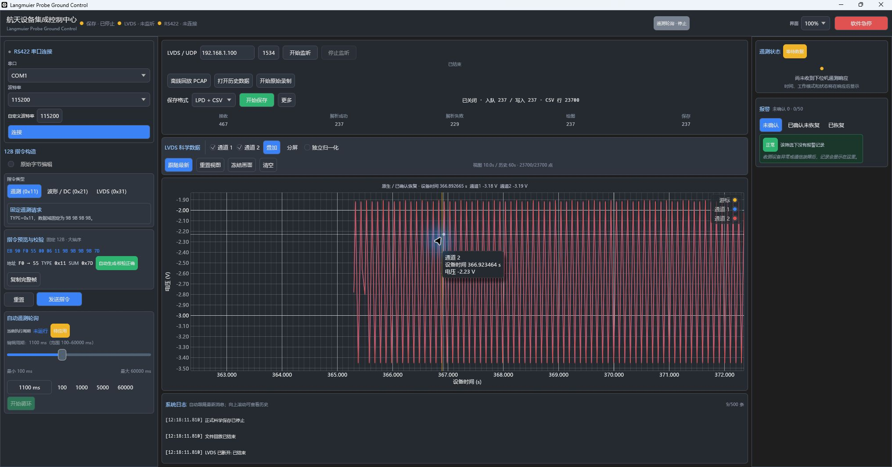
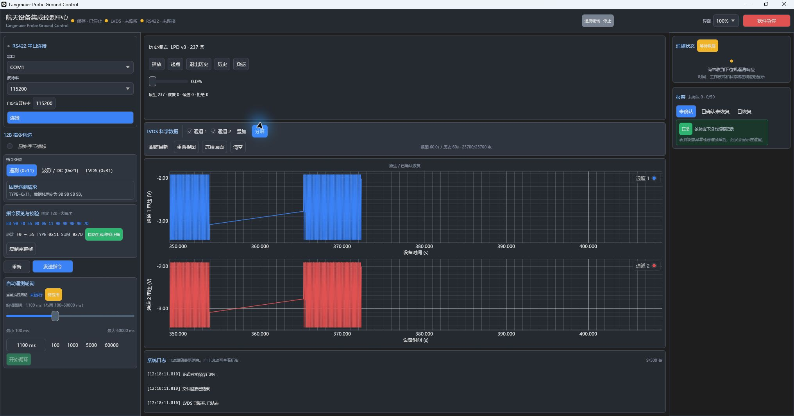
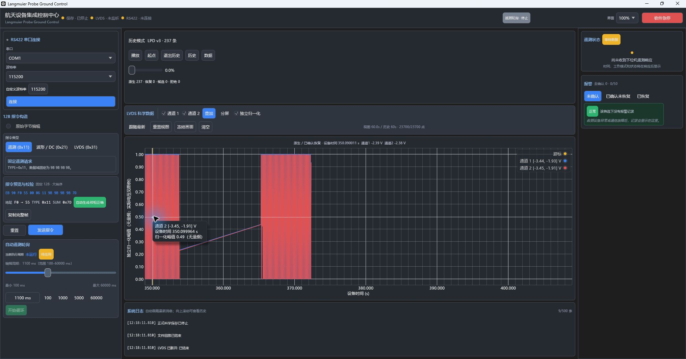
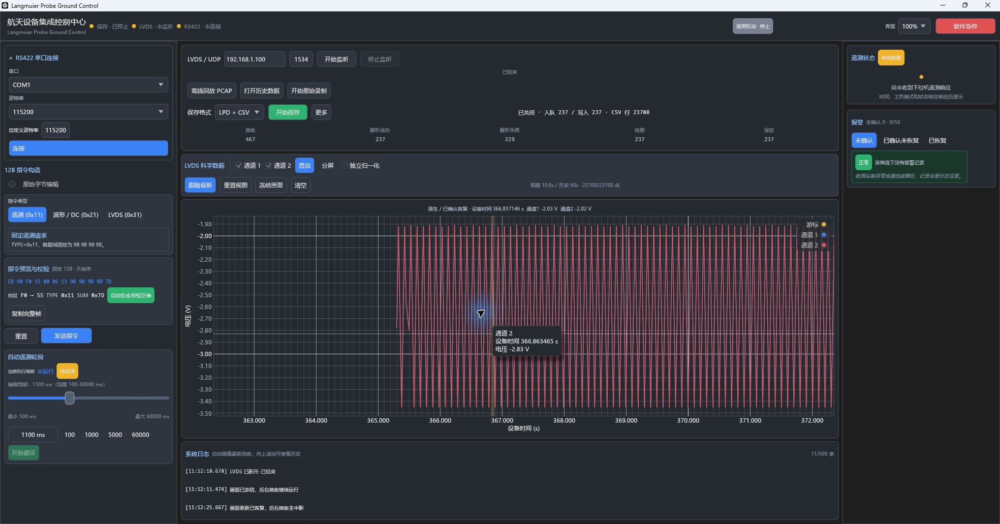
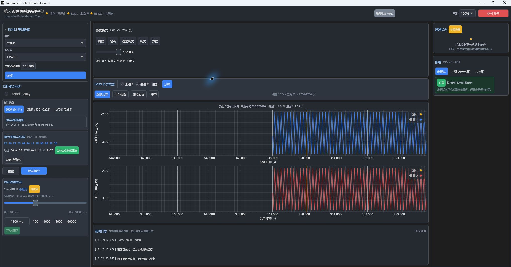
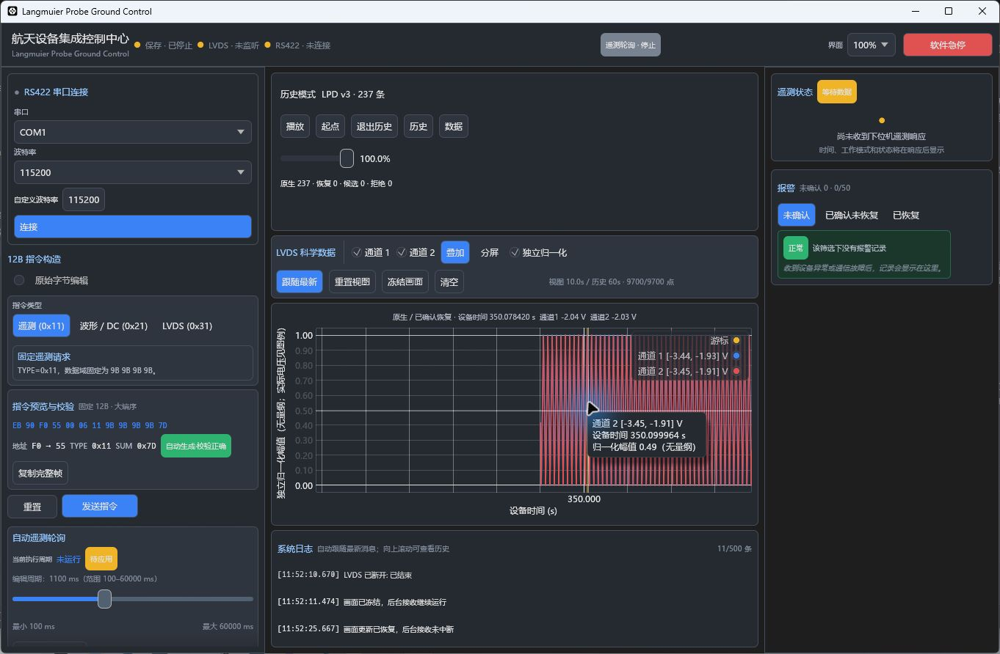
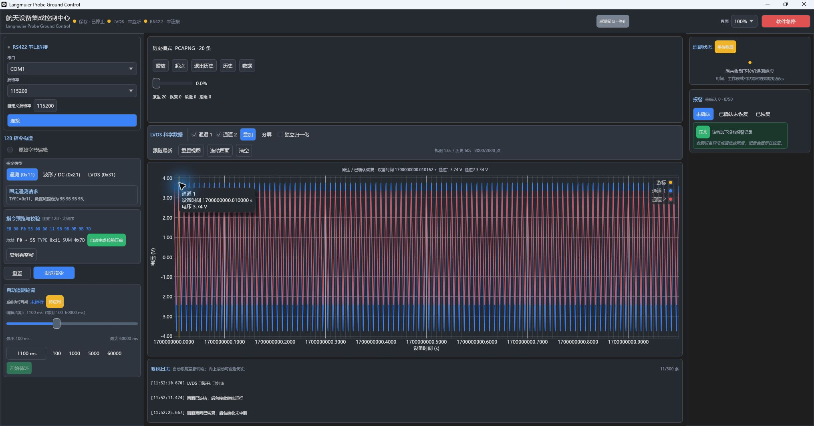

# LVDS 双通道电压显示验收

日期：2026-10-25。软件名称：**Langmuier Probe Ground Control**。

当前状态：**PASS（软件显示、实际文件及正式 Windows 包验收）**。两路显示缓存统一换算为 V，实时/PCAP/历史使用同一入口；原始科学数据保持不变。四条指定检查全部退出 0，合计 **357 通过、7 显式忽略、0 失败**。最终 Windows x64 非 Mock 静态 CRT 包已重新构建、启动并完成实际 PCAP、LPD、归一化与用户 TXT 正负电压检查；新保存 CSV/LPD 与修改前 ADC 显示版产物逐字节相同。详细交互证据按前一电压包与最终包分别标明，两包可执行代码节完全一致。真实硬件接收及物理电压标定 **NOT_RUN**，范围见第 9 节。

## 1. 范围与显示换算

本轮仅将 LVDS 双通道图表、顶部鼠标读数及历史波形的显示值统一为 V。ADS8691 的本次明确显示范围采用 Vref=4.096V、±1.25×Vref，即 -5.12V 至 +5.11V，10bit 步距为 0.01V。该范围来自用户提供的硬件说明；没有新增量程选择或标定系统。

```text
adc16 = code10 * 64 - 32768
voltage_v = adc16 * 0.00015625
          = code10 * 0.01 - 5.12
```

生产桥接事件现有值为 signed ADC16，生产显示入口执行一次 ADC16→V。后端事件、269B 科学解码及科学保存链保留原值。计算使用 f64；显示读数保留两位小数，不提前取整，不使用旧 mV 估算公式。

| code10 | 重建 ADC16 | 电压 | 默认读数 |
|---:|---:|---:|---|
| 0 | -32768 | -5.12 | -5.12 V |
| 256 | -16384 | -2.56 | -2.56 V |
| 512 | 0 | 0.00 | 0.00 V |
| 701 | 12096 | 1.89 | 1.89 V |
| 702 | 12160 | 1.90 | 1.90 V |
| 825 | 20032 | 3.13 | 3.13 V |
| 1023 | 32704 | 5.11 | 5.11 V |

生产 `voltage::tests::hardware_voltage_cases_match_literal_values_and_two_decimal_readings` 已检查上表全部 literal、ADC16 重建、双公式一致性及两位格式；最终工作区测试通过。独立标准库脚本额外遍历 0..1023，验证两个公式误差小于 1e-12。后者是独立参考证据，不与生产 Rust 用例数量累加。

证据：[actual-voltage-data-audit.json](qa/voltage-display-20261025/actual-voltage-data-audit.json)、[voltage_data_audit.py](qa/voltage-display-20261025/voltage_data_audit.py)。

## 2. 代码修改位置及数据路径

状态：**PASS（源码与自动化）**。实际修改位置如下，行号以本轮冻结源码为准：

| 位置 | 修改及作用 |
|---|---|
| [voltage.rs](../apps/desktop/src/voltage.rs)，第 6 行 | 唯一纯换算函数 `adc16_to_volts(f64) -> f64`，只乘 `0.00015625` |
| [main.rs](../apps/desktop/src/main.rs)，第 10 行 | 注册显示换算模块 |
| [app.rs](../apps/desktop/src/app.rs)，第 3158 行 | `extend_scientific_channel` 在每个新样本进入 UI 缓存时调用一次换算；普通实时、PCAP 与 qualified 实时共用此入口 |
| [app_history.rs](../apps/desktop/src/app_history.rs)，第 361、954、966、978 行 | 可靠历史样本与诊断历史样本从桥接 ADC16 生成缓存点时各转换一次；原 `HistoryWindow` 与 qualified 原帧仍保持 ADC16 |
| [app.rs](../apps/desktop/src/app.rs)，第 1981、2084、3118、3133 行 | 双路轴及顶部读数单位改 V；Y 刻度、鼠标提示和图例保留两位；归一化轴/提示明确无量纲，图例保留实际电压范围 |
| [app_plot_tests.rs](../apps/desktop/src/app_plot_tests.rs) | 合法帧、各质量路径、历史重建、归一化、鼠标提示及 Y 范围/交互回归；原有显示预期相应改 V |

显示路径如下，箭头中的乘法只发生一次：

```text
code10 → 既有 backend 重建 ADC16 → 不变的桥接事件
  ├─ 普通实时 / PCAP / qualified → extend_scientific_channel
  └─ LPD / LVDSRAW / PCAP 历史窗口 → 历史样本生成点
                                      ↓ × 0.00015625
                           既有有界 TimeSeriesBuffer（V）
                             ├─ 峰谷缓存 / 可见窗口 / 绘图
                             └─ nearest_value / 顶部实际 V
```

独立归一化只改变可见绘图缓存中的幅值，实际 V 缓冲和游标源值不变。质量筛选重建使用仍为 ADC16 的原帧/窗口，不能将已换算的缓存再次输入换算函数。冻结只复制既有 UI 缓存，不触发解码或二次换算。

已通过保护集及源码对比确认以下边界：

- 55/AA 固定头、269B、两路各 100 点、500μs、seq8 与原始设备时间不变。
- 24B UDP 外层、RS422、TTL、去重、序号监测及普通 CRC 不校验策略不变。
- `.lvdsraw` 原始字节、LPD v3 原始 code10 及普通科学 CSV 的 11 列不变。
- TimeSeriesBuffer 容量、峰谷抽稀、FollowLatest/ManualView、冻结、分屏与叠加交互不变。

终审发现历史旧 generation 测试的时间范围被误换算；已将该 `cfg(test)` fixture 恢复为合法秒范围 `[1.0, 2.0]`，没有改变生产显示、后端或存储代码。随后重新冻结清单、执行四条指定检查并重建正式包。`historical_window_rejects_stale_file_generations` 在最终 [test.log](qa/voltage-display-20261025/test.log) 中通过。

## 3. 实际输入与双通道电压对照

使用既有独立 Reader，只读 `D:\RUST\2026102401.pcapng` 和用户提供的 20 行 `lvds.txt`。没有生成替代实际科学数据。

| 输入 | 字节数 | SHA-256 |
|---|---:|---|
| `D:\RUST\2026102401.pcapng` | 172292 | `1bfe2ff956ad4e372bb15c2da04910c3d6a469b85d772ccbf83e4da4e48cca07` |
| `D:\RUST\langmuier\lvds.txt` | 10780 | `b5a2eee986fbe4f26da33da67bfeab17b8f9185f72ed0c6f81f232f3c2f15add` |

PCAP 共 467 个 UDP，无网络解析诊断，正常 EOF；分类仍是 237 原生、229 诊断候选、1 拒绝、0 已确认恢复。以下范围只统计原生 237 帧，每路 23700 点：

| 实际 PCAP 原生样本 | 通道 1 | 通道 2 |
|---|---:|---:|
| 最小 code10 / ADC16 / V | 168 / -22016 / -3.44 V | 167 / -22080 / -3.45 V |
| 最大 code10 / ADC16 / V | 319 / -12352 / -1.93 V | 321 / -12224 / -1.91 V |
| 首帧首点 code10 / ADC16 / V | 231 / -17984 / -2.81 V | 231 / -17984 / -2.81 V |
| 首帧 sample 3 | 227 / -18240 / -2.85 V | 226 / -18304 / -2.86 V |
| 负 / 零 / 正点数 | 23700 / 0 / 0 | 23700 / 0 / 0 |

首帧设备时间为 348 秒 999964 微秒、seq8=68；首点不重复增加时间偏移。此实际抓包适合检查负电压及局部范围自动拟合，不能拿它声称已覆盖正电压输入。

用户 20 行 TXT 每路 2000 点，原始码值实际跨过零点：

| 用户 TXT 样本 | 通道 1 | 通道 2 |
|---|---:|---:|
| 最小 code10 / ADC16 / V | 138 / -23936 / -3.74 V | 271 / -15424 / -2.41 V |
| 最大 code10 / ADC16 / V | 886 / 23936 / 3.74 V | 846 / 21376 / 3.34 V |
| 首帧首点 | 886 / 23936 / 3.74 V | 846 / 21376 / 3.34 V |
| 首个负值 | sample 5：480 / -2048 / -0.32 V | sample 6：471 / -2624 / -0.41 V |
| 负 / 零 / 正点数 | 1000 / 0 / 1000 | 800 / 0 / 1200 |

TXT 没有精确 code10=512 的零电压样本；真实数据显示跨零，精确 0.00V 由生产 literal 自动化测试单独覆盖。

工程现有 `lvds.pcapng` 为此前将这 20 行真实内层 HEX 加人工 UDP/PCAPNG 封装所得。独立只读核对确认 20 条、5380B 内层数据与 TXT 完全相同且顺序一致；7516B 文件 SHA-256 为 `e082a83fd079df35484f42b891b59e294849b747874be7410aedc8fee5c42813`。它可用于正式 EXE 的正负波形验证，但来源必须标记为“用户原始 LVDS HEX + 人工 UDP/PCAPNG 封装”，不能称为原始网卡抓包。

证据：[existing-txt-pcap-provenance-check.json](qa/voltage-display-20261025/existing-txt-pcap-provenance-check.json)、完整独立解码参考仅保留在本机：`D:\RUST\langmuier\target\qa\voltage-20261025\actual-pcap-reference-frames.jsonl`（未随仓库发布）。

## 4. 纵轴范围、精度及归一化

普通波形纵轴为“电压 (V)”，双路叠加与分屏使用同一换算；默认根据可见波形自动拟合并保留既有 5% 相对边距，不强制填满 -5.12..5.11V。手动平移和缩放之后新数据不能夺回视图；重置视图恢复自动拟合。

独立归一化的绘图值为 0..1，不标成真实电压；顶部读数仍给出实际两位小数 V，图例给出实际电压范围。冻结、缓存容量及峰谷保留抽稀不得改变。

状态：**PASS（最终自动化、前一电压包详细交互、最终包显示复验）**。`voltage_auto_y_fits_visible_channels_and_manual_y_survives_until_reset` 实际验证局部 -0.01..1.90V 数据的初始 Y 高度 <3V、保留小边距；左键拖动后，注入 -5.12V / +5.11V 新数据并连续重绘，X/Y 手动范围均不变；重置后自动覆盖新数据且高度 <12V。前一电压包原生 GUI 的 LPD 播放中手动范围保持、缩放、重置，以及最终包归一化/分屏/叠加复验见第 5 节；没有将前一包的完整手动操作冒称在最终包逐项重做。

`plot_left_drag_enters_manual_and_incoming_samples_do_not_steal_view`、`plot_plain_wheel_zooms_and_hover_updates`、`plot_split_synchronizes_time_and_freeze_keeps_entire_snapshot`、`plot_normalization_refits_y_without_losing_manual_time_range` 均在最终套件通过。归一化单独验证图轴无量纲、图例实际 V、顶部 `通道1 1.90 V  通道2 1.89 V`，缓存中的常量归一化为 0.5，`nearest_value` 仍为原实际 V。

性能方面，每个到达显示入口的新样本增加一次 f64 乘法，没有 UI 帧级全历史换算、重新解码或额外全历史复制；已有峰谷保留、viewport key 与借用 `PlotPoints`、60 秒容量和冻结结构保持不变，`buffer.rs` 字节哈希与本轮基线相同。此为代码路径与回归证据，不额外声称本轮完成真机吞吐或长时间基准测试。

## 5. Windows 原生 GUI 截图与历史显示

### 5.1 最终交付包

最终交付包 SHA-256 为 `f2805c059a699b02164d00da77f9b335a371954474481180fe35e3426cc9269a`，从工程可写目录重新启动，原生进程 PID=14844。以下 `LVDS_VOLTAGE_FINAL_*` 图片均来自该正式非 Mock EXE；进程路径、工作目录与 EXE 哈希见 [final-native-gui-process.json](qa/voltage-display-20261025/final-native-gui-process.json)。



原始实际 PCAP 完整回放 467 个 UDP 后，237 个原生科学帧保存成功，共 23700 CSV 行。双路叠加 Y 轴明确为“电压 (V)”，可见局部刻度约 -3.50..-1.90V。顶部时间 366.892665s 的最近原生样本为 366.892465s，相差 200μs，frame_index=127、seq8=169、sample_index=85；原始 code10=194/193，ADC16=-20352/-20416，实际 **-3.18V/-3.19V**，与顶部相同。通道 2 鼠标提示点为 366.923464s、frame_index=128、seq8=170、sample_index=47，code10=289、ADC16=-14272，即 **-2.23V**。两种选点各按图中时间独立核对，没有把它们混为同一个样本。证据：[final-gui-cursor-independent-readback.json](qa/voltage-display-20261025/final-gui-cursor-independent-readback.json)、[verify_final_voltage_gui_artifacts.py](qa/voltage-display-20261025/verify_final_voltage_gui_artifacts.py)。



本次最终 EXE 新保存的 `scientific-20261025-121748.495.lpd` 经 [历史入口打开](qa/LVDS_VOLTAGE_FINAL_LPD_OPEN.jpg)，显示 LPD v3、237 记录、首帧设备时间 348.999964s、seq8=68。叠加与分屏均为电压 V；分屏每路 23700 点，使用共同时间轴。原文件全部 code10、设备时间、seq8 与原始 PCAP 一致，且与修改前 ADC 显示版保存的科学文件逐字节相同，详见第 6 节。



最终包 LPD 归一化截图的顶部时间为 350.090011s，最近原生样本为 350.089965s，相差 46μs；code10=273/274、ADC16=-15296/-15232，对应 **-2.39/-2.38V**。通道 2 鼠标提示点时间 350.099964s、seq8=90、sample_index=0，code10=243，即实际 -2.69V；按图例真实范围 -3.45..-1.91V 归一化为 0.493506...，所以显示 **0.49（无量纲）**。Y 轴和提示不误标 V，顶部及图例保留真实电压，独立证据见 [final-normalized-cursor-independent-readback.json](qa/voltage-display-20261025/final-normalized-cursor-independent-readback.json)、[verify_final_normalized_cursor.py](qa/voltage-display-20261025/verify_final_normalized_cursor.py)。


最终包通过 [历史入口打开既有 TXT 派生 PCAP](qa/LVDS_VOLTAGE_FINAL_TXT_PCAP_OPEN.jpg)，20 条原生记录、每路 2000 点、手动时间窗 1700000000..1700000001s。取消归一化后，叠加两路实际电压，Y 刻度约 -4.00..+4.00V，包含 0.00 零轴。顶部时间 1700000000.010162s 的最近样本为 1700000000.010000s（相差 162μs），第 0 帧、seq8=0、sample_index=20，code10=886/846、ADC16=23936/21376，对应 **3.74/3.34V**；通道 1 同一原始点的鼠标提示为 **3.74V**，均一致。该 PCAP 的人工网络封装和 TXT 内层字节来源已在第 3 节说明。实际输入没有精确 code512 样本，0.00V 数值由自动化覆盖；GUI 证据证明正负电压及零轴可正常显示。证据：[final-txt-positive-cursor-independent-readback.json](qa/voltage-display-20261025/final-txt-positive-cursor-independent-readback.json)、[verify_final_txt_positive_cursor.py](qa/voltage-display-20261025/verify_final_txt_positive_cursor.py)。

最终包复验覆盖 PCAP/LPD 电压轴、顶部与鼠标读数、负/正电压、归一化、叠加及分屏；平移、缩放、跟随、冻结和重置采用最终自动化与下节前一电压包详细原生 GUI 的分层证据。独立 PE 比较证实两包生产可执行代码一致，详见第 8 节。测试结束已退出历史并关闭 PID=14844，回放和保存均已停止；没有连接 RS422 或监听硬件 UDP。

### 5.2 前一电压包的详细交互补充证据

下列 `LVDS_VOLTAGE_*`（不含 `FINAL_`）原生截图来自前一电压包，SHA-256 `71ec198e7e42ae41599e3168b1e5215a22f12ce5e8acb48fe268bbce4d11a97c`，均已显示 V，没有使用旧 ADC 版本或 Mock。该 EXE 已保留在 `target/delivery/voltage-before-fixture-correction-20261025/`，进程路径记录为 [native-gui-process.json](qa/voltage-display-20261025/native-gui-process.json)。以下结果作为该包的详细证据保留，不将其图片冒称最终包截图。

| 必测画面/操作 | 状态 | 证据 |
|---|---|---|
| 实际 PCAP 负电压双路叠加，纵轴电压 (V) | PASS | 下图刻度约 -3.50..-1.90V，符合本文件局部波形范围 |
| 顶部鼠标游标两路实际 V 读数 | PASS | 顶部 -2.03/-2.02V，通道 2 鼠标提示 -2.83V，均与独立原始样本一致 |
| 用户 TXT 派生 PCAP 正负波形与零轴 | PASS | [派生 PCAP 打开](qa/LVDS_VOLTAGE_TXT_PCAP_OPEN.jpg)、[正负分屏](qa/LVDS_VOLTAGE_TXT_POSITIVE_NEGATIVE_SPLIT.jpg)、[正负叠加](qa/LVDS_VOLTAGE_TXT_POSITIVE_NEGATIVE_OVERLAY.jpg)、[正电压游标](qa/LVDS_VOLTAGE_TXT_POSITIVE_CURSOR.jpg) |
| 归一化轴无 V、顶部与实际范围有 V | PASS | [归一化游标](qa/LVDS_VOLTAGE_NORMALIZED_CURSOR.jpg)：0.49 无量纲，顶部 -2.04/-2.03V，图例实际 V |
| 实际 LPD v3 历史双通道电压与 PCAP 一致 | PASS | [LPD 打开](qa/LVDS_VOLTAGE_LPD_OPEN.jpg) 237 记录；[LPD 分屏](qa/LVDS_VOLTAGE_LPD_SPLIT.jpg) 双轴 V；全部原始值匹配见第 6 节 |
| LVDSRAW 历史电压入口 | PASS | [RAW 打开](qa/LVDS_VOLTAGE_RAW_OPEN.jpg) 467 记录；[RAW 分屏](qa/LVDS_VOLTAGE_RAW_SPLIT.jpg) 每路 23700 原生点、双轴 V |
| 拖动、缩放、跟随、冻结、重置、分屏 | PASS（分层证据） | 原生 GUI 的播放中平移/保持、缩放、重置与分屏；冻结/恢复只在 PCAP EOF 手测，incoming 冻结以自动化证据覆盖，详见下文 |



图中顶部设备时间为 366.837146s；它按时间查找最近的原始缓存点。独立查到最近原生样本为 366.836964s，相差 182μs，frame_index=126、seq8=168、sample_index=74。通道 1/2 code10 为 309/310，ADC16 为 -12992/-12928，因此实际电压为 **-2.03V / -2.02V**，与顶部一致。

鼠标提示对应另一绘图点：通道 2 设备时间 366.863465s，frame_index=127、seq8=169、sample_index=27，code10=229、ADC16=-18112，即 **-2.83V**。顶部按时间选点和鼠标提示选中的绘图点各自有明确时间，本图不把它们混为同一个样本。

独立证据：[gui-cursor-independent-readback.json](qa/voltage-display-20261025/gui-cursor-independent-readback.json)、[verify_voltage_gui_artifacts.py](qa/voltage-display-20261025/verify_voltage_gui_artifacts.py)。



本轮新保存的 `scientific-20261025-115147.359.lpd` 已通过软件历史入口打开，237 记录、内层 seq8 和原始设备时间可见，叠加与分屏均显示 V。分屏共享时间轴，各通道保留实际电压值，不应用叠加归一化。

播放中的左键拖动确实进入 ManualView，“跟随最新”不再选中；手动 X 窗约 343.85..353.85s。[平移时进度 62.7%](qa/LVDS_VOLTAGE_LPD_PAN_MANUAL.jpg) 到 [进度 100% 后保留](qa/LVDS_VOLTAGE_LPD_MANUAL_RETAINED.jpg) 的画面显示同一手动窗口及相同游标/波形位置，新播放进度没有夺回视图。更早在 EOF 状态下的拖动只改变了游标，不作为平移通过证据。

滚轮缩放由 [缩放前 10.0s](qa/LVDS_VOLTAGE_MANUAL_BEFORE_ZOOM.jpg) 变为 [缩放后 23.5s](qa/LVDS_VOLTAGE_ZOOM.jpg)，X/Y 比例均可改变。点击 [重置视图](qa/LVDS_VOLTAGE_RESET_FOLLOW.jpg) 后“跟随最新”重新选中、窗口恢复 10.0s、Y 根据局部波形自动拟合。此证据证明恢复 FollowLatest 与自动拟合，不声称它跳到历史 EOF。

PCAP EOF 状态已手动检查冻结/恢复按钮；后台持续输入时的冻结保持由最终自动用例 `plot_split_synchronizes_time_and_freeze_keeps_entire_snapshot` 验证，不将 EOF 手测扩大为真实硬件持续输入验收。



归一化图中，Y 轴和鼠标幅值明确为无量纲。顶部时间 350.078420s 的最近原生样本为 350.078465s（相差 45μs），code10=308/309，即实际 **-2.04/-2.03V**。通道 2 提示点时间 350.099964s，code10=243，实际 -2.69V；使用图例范围 -3.45..-1.91V 归一化得到 `(-2.69 + 3.45) / 1.54 = 0.493506...`，因此提示 **0.49（无量纲）** 正确，未误标为 V。

LPD 平移截图的顶部时间 350.894364s 最近样本为 350.894464s，code10=268/269，对应 -2.44/-2.43V；提示点 350.911464s 的通道 2 code10=216，对应 -2.96V，也与原始实际 PCAP 独立查找一致。证据：[history-cursor-independent-readback.json](qa/voltage-display-20261025/history-cursor-independent-readback.json)、[verify_history_cursor_readback.py](qa/voltage-display-20261025/verify_history_cursor_readback.py)。

既有实际原始归档 `raw-20261025-024836-232.lvdsraw` 也可打开并分屏显示 V。RAW 截图的恢复功能关闭，界面统计 237 原生、230 拒绝；这是当前关闭恢复的显示/接收分类，不与独立完整位审计的 229 候选 + 1 拒绝混用，也不声称已经恢复任何缺失数据。



最后打开工程现有 `lvds.pcapng`，20 原生帧；手动时间窗为 1700000000..1700000001s，每路 2000 点。它的 20 个内层科学帧已独立证明与用户 `lvds.txt` 逐字节及顺序一致；网络封装为人工添加，**不是实际网络抓包**。分屏及叠加画面均显示正负电压、0.00 刻度和正确 V 轴；未为了零点验收修改原始输入。

正游标截图顶部设备时间为 1700000000.010162s，独立最近样本为第 0 帧、seq8=0、sample_index=20，时间 1700000000.010000s，相差 162μs。通道 1/2 原始 code10=886/846、ADC16=23936/21376，实际为 **3.74V / 3.34V**，与顶部和通道 1 鼠标提示 **3.74V** 一致。真实 TXT 没有精确 code512 样本，所以 GUI 证明正负及跨零轴，精确 0.00V 点由生产 literal 和合法帧自动化覆盖。证据：[txt-positive-cursor-independent-readback.json](qa/voltage-display-20261025/txt-positive-cursor-independent-readback.json)、[verify_txt_positive_cursor.py](qa/voltage-display-20261025/verify_txt_positive_cursor.py)。

初次通过应用启动接口运行时继承了不可写工作目录，科学保存提示目录错误；已关闭该实例，并从工程可写目录重新启动同一 EXE，此后完整保存和读取成功。该现象属于启动目录条件，未因此修改代码。原始记录见 [启动目录错误截图](qa/LVDS_VOLTAGE_LAUNCH_DIRECTORY_ERROR.jpg)。

## 6. 原始 CSV / LPD / LVDSRAW 兼容证据

保护集 `unchanged-baseline.json` 共 12 项：buffer、backend、backend_history、bridge、核心 LVDS 解码、LPD v3、科学 CSV 源码，加两个实际输入和既有 LPD/CSV/LVDSRAW 文件。独立审计及最终源码冻结后重新核对，大小及 SHA-256 全部一致，证明没有改写这些已存在文件。`freeze_source_manifest.py` 同时核对 **73 个源码/清单文件**和 **3 个上一版交付备份**，结果 PASS；它记录本轮冻结内容并在复验时要求完全一致。

既有科学文件重新由独立 Python 读取并与本轮实际 PCAP 独立逐点解码比较：

| 文件 | 状态 | 完整读回结果 |
|---|---|---|
| `data/scientific-20261025-023840.901.csv` | PASS | 23700 数据行、严格 11 列、260700 个字段一致；47400 个原始码值及重建 ADC16、时间、seq8 全相同 |
| `data/scientific-20261025-023840.901.lpd` | PASS | v3、96973B、237 记录、47400 个原始 code10 和全部设备时间/seq8 一致，恰好 EOF |

最终交付包（`f280...269a`）从原始实际 PCAP 完整回放至 EOF，并新保存以下科学文件。独立 Python Reader 完整读回，与同一原始 PCAP 逐点比较；另将两个新文件与修改前 ADC 显示版文件、前一电压包文件分别执行 `read_bytes()` 比较：

| 最终交付包正式 GUI 输出 | 状态 | 验证结果 |
|---|---|---|
| `data/scientific-20261025-121748.495.csv` | PASS | 1636896B、23700 行、严格 11 列；260700 字段、47400 code10 及对应 ADC16、设备时间和 seq8 全部一致 |
| `data/scientific-20261025-121748.495.lpd` | PASS | 96973B、v3、237 记录；47400 原始 code10、设备时间、seq8 和 EOF 全部一致 |
| 最终文件与旧 ADC / 前一电压包逐字节比较 | PASS | CSV 与 CSV、LPD 与 LPD 各自完全相同；显示单位改变没有写入原始科学文件 |

最终包证据：[final-gui-storage-independent-readback.json](qa/voltage-display-20261025/final-gui-storage-independent-readback.json)、[final-vs-existing-storage-byte-identity.json](qa/voltage-display-20261025/final-vs-existing-storage-byte-identity.json)、[verify_final_voltage_gui_artifacts.py](qa/voltage-display-20261025/verify_final_voltage_gui_artifacts.py)。

前一电压包（`71ec...a97c`）的完整回放输出也保留，分别核对，不将其文件归到最终 EXE：

| 前一电压包正式 GUI 输出 | 状态 | 验证结果 |
|---|---|---|
| `data/scientific-20261025-115147.359.csv` | PASS | 1636896B、23700 行、严格 11 列；全部 260700 字段与独立原始 PCAP 参考一致 |
| `data/scientific-20261025-115147.359.lpd` | PASS | 96973B、v3、237 记录；47400 原始 code10、设备时间、seq8 和 EOF 全部一致 |
| 新文件与修改前输出逐字节比较 | PASS | CSV、LPD 各自 `read_bytes()` 完全相同，大小及 SHA-256 均相同；显示换算没有进入科学文件 |

既有 CSV SHA-256：`33ea097d21848a631618bb29b02b2de5685184ea47d818135234ad0da20ff97e`。

既有 LPD SHA-256：`befe6135c42c27f20bb492d5bb60e2ecf6f86a8bb965f19bbe3a4c6636714d10`。

新旧 CSV 都为 SHA-256 `33ea097d21848a631618bb29b02b2de5685184ea47d818135234ad0da20ff97e`；新旧 LPD 都为 SHA-256 `befe6135c42c27f20bb492d5bb60e2ecf6f86a8bb965f19bbe3a4c6636714d10`。

证据：[new-gui-storage-independent-readback.json](qa/voltage-display-20261025/new-gui-storage-independent-readback.json)、[new-vs-existing-storage-byte-identity.json](qa/voltage-display-20261025/new-vs-existing-storage-byte-identity.json)、[existing-storage-independent-readback.json](qa/voltage-display-20261025/existing-storage-independent-readback.json)、[actual_gui_science_verify.py](qa/voltage-display-20261025/actual_gui_science_verify.py)、[unchanged-baseline.json](qa/voltage-display-20261025/unchanged-baseline.json)、[frozen-source-manifest.json](qa/voltage-display-20261025/frozen-source-manifest.json)、[freeze_source_manifest.py](qa/voltage-display-20261025/freeze_source_manifest.py)。

## 7. T1–T7 自动化及实际验收

| 编号 | 要求 | 当前状态 | 证据范围 |
|---|---|---|---|
| T1 | 7 项纯数值及两位格式 | PASS | 生产 literal 测试；独立全 1024 code 双公式一致，误差 <1e-12 |
| T2 | 合法科学帧双路各 100 点逐点 V | 自动化 PASS | literal 55/AA 帧经生产解码后构造既有桥接事件，双路 100 点和 500μs 时间逐点一致；不是现场 UDP 验收 |
| T3 | 实际波形 V 纵轴与鼠标读数 | 最终包 PASS | 最终非 Mock GUI 实际 PCAP 电压纵轴；顶部 -3.18/-3.19V、通道 2 提示 -2.23V，与原始样本独立查找相同 |
| T4 | 负电压与零点 | 最终自动化/最终包 GUI PASS | 最终实际 PCAP 负电压；TXT 派生 PCAP 正负/零刻度/正游标；合法帧和 literal 精确 0.00V |
| T5 | 平移、缩放、跟随、冻结、叠加、分屏 | PASS（分层证据） | 最终自动化；前一电压包播放中手动窗口保持、缩放/跟随/重置及 EOF 冻结；最终包叠加/分屏/归一化复验。两包可执行代码一致，incoming 冻结由自动化覆盖 |
| T6 | 实际 LPD 与实时/PCAP 相同电压 | 最终自动化/最终包 GUI PASS | 最终新 LPD 237 条、双轴 V、每路 23700 点；全部原始值匹配同一 PCAP，旧包详细游标证据另列 |
| T7 | CSV 11 列及 LPD v3 原始数据保持 | 最终包完整保存 PASS | `121748.495` 由最终 EXE 保存，逐字段匹配 PCAP，并与旧 ADC 及前一电压包科学文件分别逐字节一致 |

以下命令均已在本轮冻结源码实际执行，不引用上一阶段结果：

```powershell
cargo fmt --all -- --check
cargo check --workspace --locked
cargo test --workspace --features langmuir-desktop/mock --locked
cargo clippy --workspace --all-targets --locked -- -D warnings
```

| 命令 | 中国标准时间开始/结束 | 退出码 | 日志 |
|---|---|---:|---|
| fmt | 12:13:03 / 12:13:05 | 0 | [fmt.log](qa/voltage-display-20261025/fmt.log) |
| workspace check | 12:13:05 / 12:13:07 | 0 | [check.log](qa/voltage-display-20261025/check.log) |
| workspace tests + mock feature | 12:13:07 / 12:13:49 | 0 | [test.log](qa/voltage-display-20261025/test.log) |
| workspace all-targets strict clippy | 12:13:49 / 12:13:55 | 0 | [clippy.log](qa/voltage-display-20261025/clippy.log) |

测试逐套件计数为：core 99 通过/1 忽略；desktop 191 通过/6 忽略；protocol-cli 6、storage 36、transport 25 通过；合计 **357 通过、7 忽略、0 失败**。7 个忽略项为既有显式 CPU bench 或依赖用户文件环境变量的测试，不计为本轮已执行；独立 Python 实际文件审计另列。开启 Mock 的工作区测试只用于自动化，正式发布与 GUI 验收不启用 Mock。

可信的实施前 RED 是 [display-red.log](qa/voltage-display-20261025/display-red.log)：6 项电压显示测试全部失败，包含 `ADC -32768` 对 `-5.12V`、V 轴与归一化标签缺失等实际断言。实施后以上 6 项、后续新增鼠标提示和纯数值测试均在最终 [test.log](qa/voltage-display-20261025/test.log) 通过。其他中间调查/阶段日志不作为本报告的最终 RED 或通过证据，也不与最终套件累加。

完整命令及精确时间见 [required-checks.json](qa/voltage-display-20261025/required-checks.json)。

## 8. Windows x64 正式构建与校验

按 [WINDOWS_BUILD.md](WINDOWS_BUILD.md) 使用静态 CRT 和最新源码：

```powershell
$env:RUSTFLAGS = '-C target-feature=+crt-static'
cargo +stable-x86_64-pc-windows-msvc build --release -p langmuir-desktop --target x86_64-pc-windows-msvc --target-dir target --no-default-features --locked
```

状态：**PASS（最终正式构建与包校验）**。修正仅测试 fixture 并重新冻结源码后，2026-10-25 12:14:24..12:14:54 +08 实际重建，退出码 0，Release 日志记录完成耗时 **30.09 秒**；未复用此前 ADC 显示 EXE 或前一电压包。包核验通过 PE32+ x64、无动态 MSVC CRT、构建源 EXE/交付 EXE/ZIP 内 EXE 字节一致、README 字节一致和 ZIP CRC；ZIP 恰好包含 EXE 与 README 两项。Mock 与 HDF5 feature 均关闭。程序界面和数据验收另见第 5、6 节，不能只以包校验代替 GUI。

| 交付物 | 字节数 | SHA-256 |
|---|---:|---|
| `target/delivery/windows-x64/LangmuierProbeGroundControl.exe` | 10176512 | `f2805c059a699b02164d00da77f9b335a371954474481180fe35e3426cc9269a` |
| `target/delivery/LangmuierProbeGroundControl-windows-x64.zip` | 4210621 | `0931228e43429f9b356d8286cea781aba33a26e00a1bc6769699903faf02cd93` |
| `target/delivery/windows-x64/README.md` | 3690 | `9ff420fd95d80f5a84feef765c9b377543c2f125897b638e1b609e4bb164036a` |

独立逐字节比较前一电压包与最终 EXE，二者同为 10176512B、节布局相同。仅 **24 字节**不同，全部在已解析字段内：COFF 时间戳 2 字节、3 个调试目录时间戳各 2 字节、CodeView RSDS GUID 16 字节；无未解释差异。`.text` 的 6715392B、`.data`、`.pdata`、`.fptable`、`.reloc` 均逐字节相同；`.rdata` 仅包含上述 22 字节调试元数据差异。此结果明确二进制差异边界；最终 EXE 仍已重新启动并完成第 5.1 节单独列出的原生 GUI 复验。

构建与包证据：[windows-release-build-result.json](qa/voltage-display-20261025/windows-release-build-result.json)、[windows-release-build.log](qa/voltage-display-20261025/windows-release-build.log)、[windows-package-acceptance-verification.json](qa/voltage-display-20261025/windows-package-acceptance-verification.json)、[verify_windows_acceptance_package.py](qa/voltage-display-20261025/verify_windows_acceptance_package.py)、[pe-fixture-correction-comparison.json](qa/voltage-display-20261025/pe-fixture-correction-comparison.json)、[compare_fixture_correction_pe.py](qa/voltage-display-20261025/compare_fixture_correction_pe.py)。

## 9. 未测边界

本轮没有连接真实硬件、改变 Windows IP、发送 RS422 控制指令或执行物理电压校准。PCAP/LPD/LVDSRAW 的真实文件读回与正式 GUI 测试不等于设备实时吞吐或模拟输入电压计量验收。0.01V 是本次用户给出的 10bit 显示量化步距，不是 ADC 器件完整误差、模拟链路精度或绝对标定结论。

状态明确为：真实设备 UDP 接收 **NOT_RUN**；硬件模拟输入和绝对电压标定 **NOT_RUN**；本轮没有新增真机长时间性能或物理故障验收。已执行的软件数值、协议帧至显示入口、实际文件、前一电压包详细交互及最终包原生 GUI 证据见各节，不把未测项混入通过数量。

验收阶段的冻结证据索引见 [final-evidence-manifest.json](qa/voltage-display-20261025/final-evidence-manifest.json)，原检查脚本为 [check_report_evidence.py](qa/voltage-display-20261025/check_report_evidence.py)。这份清单及其脚本按验收完成时的原字节保留；其中报告/计划哈希对应发布整理前备份，不代表下节整理后的文档哈希。冻结清单中的生产源码、EXE 和 ZIP 哈希仍与本次发布对象一致。清单不生成或修改科学数据。

验收阶段遵循当时“不自动提交 Git”的约束，完成后停止；没有增加 CSV 电压列或扩展量程系统。用户随后已明确授权本次 GitHub 发布，以下仅整理发布文档与证据，不改写既有验收结果。


## 10. 后续授权的发布整理

2026-10-25，用户在本阶段验收结束后授权上传 GitHub。本次将报告引用的精选 JSON、日志和 Python 审计脚本逐字节复制至 `docs/qa/voltage-display-20261025/`，使仓库内链接可持续访问；[目录说明](qa/voltage-display-20261025/README.md) 记录保留范围和脚本依赖。没有复制完整解码 JSONL、原始抓包、TXT、CSV、LPD、LVDSRAW 或应用源码备份。

原报告和计划已逐字节备份至本机 `target/qa/voltage-20261025/publication-backup/`，原冻结验收清单未覆写。当前报告、计划和精选证据的 SHA-256 及链接核对见 [publication-manifest.json](qa/voltage-display-20261025/publication-manifest.json)，不包含清单自身的哈希。该清单记录发布整理状态，不替代原验收清单，也不声称重新运行 Cargo、正式构建、GUI 或真实数据验收。
